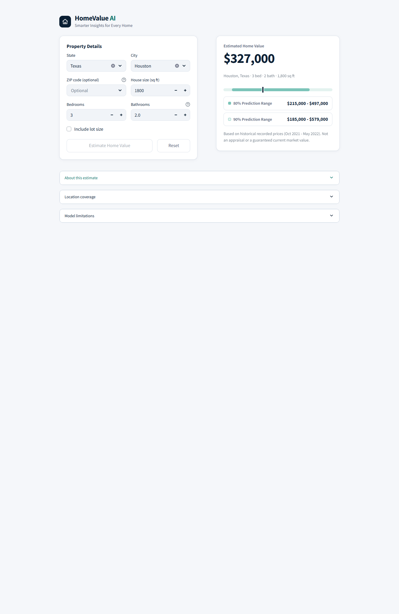

# HomeValue AI

House price estimation with calibrated prediction ranges, built end to end for a Data Warehouse and Data Mining course:
data cleaning, a PostgreSQL star-schema warehouse, model training and evaluation, and a Streamlit web app.



> **What an estimate means.** The model predicts the *recorded price* of `sold`-status listings (Realtor.com data,
> about October 2021 to May 2022). These are not verified sale prices. Output is a historical reference, **not an appraisal
> or a current market value**.

## Highlights

| | |
|---|---|
| Data | 2.2M raw listings, 696,287 clean sold records |
| Warehouse | PostgreSQL 17 star schema, idempotent ETL, 52/52 validation checks |
| Model | Gradient boosting on log price, with optional ZIP-level hybrid |
| Accuracy (test, 139,100 homes) | MAE $98,281, R² 0.745, median error 13.8% (with ZIP) |
| Ranges | 80% and 90% split-conformal, tested coverage 80.4% / 90.2% |
| Testing | 138 automated tests, 100 real-browser checks |

## Quick start

Python 3.10 was used.

```bash
pip install -r requirements.txt
streamlit run app/streamlit_app.py
```

The app reads only the files in `models/`. It needs no database and does not retrain. Open http://localhost:8501.

## Using the app

Choose a state and city, optionally a ZIP code, then enter bedrooms, bathrooms and house size (lot size is optional).
The result shows the estimate with 80% and 90% prediction ranges.

- Cities with too little reliable data are never offered an estimate; limited-coverage cities are labelled and warned about.
- A ZIP is used only if recorded with the chosen city. ZIPs with fewer than 5 training records fall back to the city-level estimate.
- Ranges are an average over many homes, not a guarantee for one property. Coverage is weaker below $100,000 and above $2 million.

## Results (held-out test split)

| Model | MAE | RMSE | R² | Median % error |
|---|---:|---:|---:|---:|
| Median baseline | $282,014 | $712,215 | -0.041 | 43.8% |
| Ridge (log price) | $124,699 | $424,927 | 0.629 | 17.5% |
| Random forest (log price) | $111,134 | $424,167 | 0.631 | 15.1% |
| **Gradient boosting (log price), no ZIP** | **$106,982** | **$383,269** | **0.699** | **14.9%** |
| Hybrid with ZIP (v2, installed) | $98,281 | $352,288 | 0.745 | 13.8% |

Cities never seen in training had a median error of 33.3% against 15.0% for seen cities, so they are not estimated.
Details: `reports/model_comparison.md`, `reports/zip_feature_experiment.md`.

## Pipeline

1. **Cleaning** (`src/data_cleaning.py`): removes incomplete, implausible and duplicate records; quarantines rather than deletes; never imputes price.
2. **Warehouse** (`sql/`, `src/warehouse_etl.py`): `fact_property_listing` with `dim_location`, `dim_property` and `dim_date`, plus staging and audit schemas.
3. **Modelling** (`src/train_model.py`, `src/zip_experiment.py`): group-aware 60/10/10/20 split, leakage controls, cross-fitted location encoding, conformal ranges.
4. **App** (`app/`): validated predictions through `src/predict.py`.

## Reproducing

```bash
python src/data_cleaning.py                    # raw CSV -> data/processed
cp .env.example .env                           # then fill in the PG* settings
python src/warehouse_etl.py all --create-db    # create, load and validate the warehouse
python src/train_model.py                      # train and write models/
python src/zip_experiment.py                   # ZIP experiment, validation stage
python src/zip_experiment.py --test            # single test evaluation (refuses a second run)
python src/integrate_zip_model.py              # build the v2 hybrid artifacts
```

The seed is 42 and splits are a deterministic hash, so reruns reproduce the cleaned files and v2 artifacts.
Large data files and `.env` are git-ignored. Versions: pandas 2.2.3, NumPy 1.26.4, scikit-learn 1.7.2, Streamlit 1.45.

## Tests

```bash
python -m pytest tests -q
```

138 tests cover leakage controls, prediction validation, the ZIP experiment and integration, and the app (via Streamlit `AppTest`).
`tests/browser_check.py` is a separate Playwright check (Chromium, 1366 px and 390 px): 89 functional checks plus 11 for the
model-load failure page, all passing. Results are in `reports/figures/app_screenshots/browser_check_results.json`.
Not tested: Firefox, Safari, real phones and colour contrast.

## Project structure

```text
app/         Streamlit app and styling
src/         Cleaning, ETL, training, prediction
sql/         Warehouse DDL, load script, example analytical queries
models/      Installed v2 artifacts; backups/v1_no_zip holds the verified v1 files
reports/     Final report, profiling, model and warehouse reports, figures
tests/       pytest suites and the browser check
notebooks/   Exploratory analysis
```

## Rollback to v1 (no ZIP)

1. Copy the files in `models/backups/v1_no_zip/` into `models/` and check them against `MANIFEST.json`.
2. Move `models/zip_model.joblib` and `models/zip_city_map.csv` out of `models/`. The app then hides the ZIP field.
3. Run the tests; the v2 integration tests skip themselves.

Verified in an isolated copy: 105 passed, 33 skipped, v1 metrics reproduced exactly.

## Limitations

- The target is a recorded price from late 2021 to mid-2022, not a verified or current value.
- The model sees only location, bedrooms, bathrooms, size and lot. Condition, age and exact address are unknown.
- Many cities and some states have too little data (770 supported, 1,665 limited).
- ZIP-city pairs come from the dataset and are not independently verified.

## Data and licence

Source: [USA Real Estate Dataset](https://www.kaggle.com/datasets/ahmedshahriarsakib/usa-real-estate-dataset) on Kaggle
(Ahmed Shahriar Sakib; listings from Realtor.com). Its terms say the data is for educational purposes only, so use this
project for coursework, not commercially. The raw data is not included in this repository.

Full write-up: `reports/final_report.md`.
