> **DRAFT FOR STUDENT REVIEW. Delete this box before submission.** Items in [square brackets] are placeholders for details
> that are not recorded anywhere in the project (names, course code, dates, academic-integrity statement). The figures in
> this report were checked against the project's own result files; see Appendix E for the evidence map. The report does not
> claim to satisfy any particular grading rubric.

<br>

# HomeValue AI: A Data-Driven House Price Recommendation System Using Machine Learning and Data Warehousing

**Course:** Data Warehouse and Data Mining
**Student:** [Student name] ([Student ID])
**Instructor:** [Instructor name]
**Institution:** [University name]
**Submission date:** [Date of submission]

<br>

## Abstract

Estimating what a home is worth is difficult when prices are recorded without detailed property information and when data
quality is uneven. This project builds an end-to-end analytical system on a public U.S. real-estate dataset of 2,226,382
listing records. A reproducible cleaning pipeline reduces the raw file to 696,287 complete `sold`-status records (with 704
more quarantined for review), which are loaded into a PostgreSQL star schema with 52 automated integrity checks. On this
warehouse, regression models are trained to predict the *recorded price* of a sold-status record from its state, city,
bedrooms, bathrooms, house size and optional lot size, using a split that keeps every property in one partition. A
gradient-boosting model on the logarithm of price reached a test mean absolute error (MAE) of $106,982 (median error 14.9%,
R² 0.699). Adding an optional ZIP code through a hybrid model, which falls back to the city-level model when a ZIP has
fewer than five training records, lowered the test MAE to $98,281 (median error 13.8%, R² 0.745). Prediction ranges built
by split conformal prediction covered 80.4% and 90.2% of test homes at the nominal 80% and 90% levels. Estimates are
served through a Streamlit web application that refuses locations without enough reliable data. The system is validated by
138 automated tests and 100 real-browser checks. The main limitations are that the target is a recorded price whose
definition is not documented, the data span only about seven months (October 2021 to May 2022), accuracy is much lower for
cities never seen in training (33.3% median error against 15.0%), and prediction ranges are noticeably less reliable for
homes recorded under $100,000 or over $2 million. The system is an analytical estimate, not an appraisal.

**Keywords:** data warehouse, star schema, ETL, regression, gradient boosting, conformal prediction, real estate

<br>

## Contents

1. Introduction
2. Dataset and Data Preparation
3. Data Warehouse Design and ETL
4. Exploratory Data Analysis
5. Machine-Learning Methodology
6. Experimental Results and Evaluation
7. Application Design and Implementation
8. Testing and Validation
9. Limitations, Ethics, and Risks
10. Conclusion and Future Work
11. References
12. Appendices (A schema, B analytical SQL, C reproducibility, D further tables, E evidence map, F declaration)

---

## 1. Introduction

### 1.1 Motivation

A home buyer, a seller or an analyst often wants a quick, defensible reference value for a property. Published listing
data are plentiful but messy: values are missing, some records are implausible, the same property can appear more than
once, and the meaning of a field such as "price" is not always documented. A useful estimator therefore needs two things
beyond a model: a **trustworthy, documented data foundation** and an **honest statement of how uncertain each estimate
is**. This project addresses both, in the setting of a Data Warehouse and Data Mining course.

### 1.2 Problem statement

Given a U.S. property's location (state and city, optionally ZIP code) and basic characteristics (bedrooms, bathrooms,
house size, optionally lot size), estimate the price recorded for comparable `sold`-status listings, with calibrated
prediction ranges, and decline to answer where the data cannot support a reliable estimate.

### 1.3 Objectives

1. Clean and profile a large public real-estate listing dataset, documenting every exclusion.
2. Organise the cleaned data into a PostgreSQL dimensional warehouse with a repeatable, auditable ETL process.
3. Compare regression models for recorded price on a leakage-aware evaluation design.
4. Quantify uncertainty with prediction ranges whose coverage is checked on held-out data.
5. Deliver the result as a web application with a transparent policy for unsupported locations, and test it.

### 1.4 Scope

In scope are U.S. `sold`-status records with complete bedroom, bathroom and house-size values. Records with other statuses
are kept in the raw file but not modelled. Out of scope are current market valuation, formal appraisal, forecasting, causal
claims about what drives prices, and any fairness or regulatory assessment.

### 1.5 Research questions

The questions below were formulated while writing this report, to organise the findings. They were not pre-registered,
and the project establishes associations in one historical sample, not causation.

- **RQ1.** How can a noisy real-estate listing dataset be cleaned and organised into a reliable analytical warehouse?
- **RQ2.** How well can machine-learning regression estimate recorded housing prices from property and location features,
  and how reliable are the accompanying prediction ranges?
- **RQ3.** Does adding ZIP-code information improve predictive performance without materially degrading generalisation to
  locations the model has not seen?

### 1.6 Structure of the report

Sections 2 to 4 cover the data, the warehouse and exploratory analysis. Sections 5 and 6 describe and evaluate the models.
Sections 7 and 8 present the application and its testing. Sections 9 and 10 discuss limitations and conclusions. Supporting
material is in the appendices.

---

## 2. Dataset and Data Preparation

### 2.1 Source and provenance

The data come from the Kaggle dataset "USA Real Estate Dataset", uploaded by Ahmed Shahriar Sakib (Sakib, 2024). Kaggle's public
metadata for the dataset, retrieved on 28 October 2026, gives the subtitle "Real Estate listings (2.2M+) in the US broken by State and zip
code", version 25, last updated 30 March 2024, and the licence as "Other (specified in description)", which means the terms are those
written in the description. The description names Realtor.com, "a real estate listing website operated by the News Corp subsidiary Move,
Inc.", as the data source, and states: "The data and information in the data set provided here are intended to use for educational
purposes only." and "I do not own any data, and all rights are reserved to the respective owners." The project therefore treats the
data as **third-party data used for education**: the listings belong to their owners, this is university coursework, the raw data are
not redistributed with the project, and nothing in it should be used commercially. These details were obtained through a web-fetch tool
and are quoted as that tool returned them; the Kaggle page itself could not be rendered, so the wording should be rechecked in a browser.

The project file is `realtor-data.zip.csv.zip`, a 40,085,115-byte archive of one CSV (178,858,272 bytes uncompressed) with 12 columns.
The description returned by the tool refers to a CSV with 10 columns, so the downloaded file appears to come from a later version of the
dataset; the version number of the download was not recorded, and no data dictionary (for example for `price`, `status` and
`prev_sold_date`) was retrieved. The raw file's SHA-256 (`4a31b6fe…127d1`, full value in `reports/cleaning_summary.json`) is recorded
so that every later step can be tied to the exact file used, and the raw file was never modified.

### 2.2 Original schema and scale

The raw file has 2,226,382 rows and 12 columns (Table 1). Some column meanings below are *interpretations*, not
documentation: no data dictionary was available.

**Table 1. Raw columns, types and missingness (all 2,226,382 rows).**

| Column | Stored as | Interpretation | Missing | Distinct values |
|---|---|---|---:|---:|
| `brokered_by` | object | numeric code (meaning not documented) | 0.20% | 110,143 |
| `status` | object | listing status (for_sale, sold, ready_to_build) | 0.00% | 3 |
| `price` | object | price in dollars (definition not documented) | 0.07% | 102,137 |
| `bed` | object | bedrooms | 21.62% | 99 |
| `bath` | object | bathrooms | 22.99% | 86 |
| `acre_lot` | object | lot size, interpreted as acres | 14.62% | 16,057 |
| `street` | object | numeric code, not a street name | 0.49% | 2,001,358 |
| `city` | object | city name | 0.06% | 20,098 |
| `state` | object | state or territory name | 0.00% | 55 |
| `zip_code` | object | ZIP code stored as a number (leading zeros lost) | 0.01% | 30,334 |
| `house_size` | object | interpreted as square feet | 25.53% | 12,061 |
| `prev_sold_date` | object | previous sold date, as text | 32.98% | 14,954 |

*Source: `reports/phase1_schema_missingness.csv`. Interpretations are the project's, not the publisher's.*

Three columns are stored as floating-point numbers although they are identifiers: `zip_code` (which loses its leading zero:
00601 becomes 601), `street` and `brokered_by` (numeric codes, not names). ZIP codes were therefore rebuilt as
five-character text, and 40,234 cleaned rows have a ZIP starting with 0.

### 2.3 What the target is, and is not

The modelling target is the **recorded `price` of records whose `status` is `sold`**. The project does not treat this as a
verified completed-sale price: the dataset's documentation for the field could not be retrieved, and the same column
holds the price of `for_sale` rows, presumably a listing price. Table 2 shows that the three statuses differ in their price
distributions.

**Table 2. Raw rows and price by listing status.**

| Status | Rows | Share | Median price | 1st percentile | 99th percentile | Maximum | `prev_sold_date` missing |
|---|---:|---:|---:|---:|---:|---:|---:|
| `for_sale` | 1,389,306 | 62.4% | $305,000 | $9,000 | $4,585,000 | $2,147,483,600 | 51% |
| `ready_to_build` | 25,067 | 1.1% | $454,210 | $0 | $1,550,244 | $4,900,000 | 100% |
| `sold` | 812,009 | 36.5% | $344,900 | $17,032 | $2,821,850 | $295,000,000 | 0% |

*Source: `reports/phase1_status_summary.csv`.*

For `sold` rows the column `prev_sold_date` is never missing, and its values lie between 2021-10-18 and 2022-05-06
(Section 4.4). It is probably the sale date, but this is an inference. The project therefore (a) does not use the date as a
model feature and (b) stores it in the warehouse under its source name (`prev_sold_date_key`) and never calls it a sale or
closing date.

### 2.4 Data-quality problems found

Figure 1 summarises the main problems.

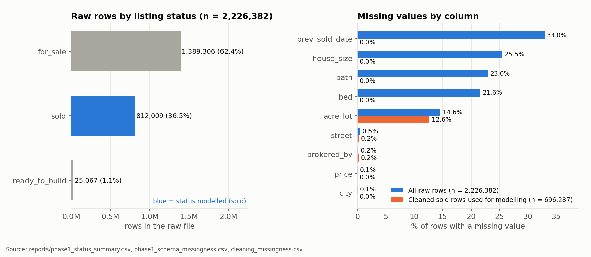

**Figure 1.** Left: raw rows by listing status (n = 2,226,382). Right: share of rows with a missing value, per column, in
the raw file and in the cleaned sold rows kept for modelling (n = 696,287). *Source: `reports/phase1_*.csv`,
`reports/cleaning_missingness.csv`.*

- **Missing values.** Bedrooms (21.6%), bathrooms (23.0%), house size (25.5%), lot size (14.6%) and previous sold date
  (33.0%) are missing in large shares of the raw rows; price is missing in 0.07%.
- **Duplicates.** No raw row is an exact duplicate of another. No unique listing identifier exists, so a *provisional*
  property key was formed from `(street, zip_code)`: it identifies 2,044,747 distinct addresses, of which 143,795 appear in
  more than one row (314,332 rows, up to 98 rows for one address). 11,098 rows lack a street or ZIP and cannot be keyed.
- **Implausible values** (Table 3), such as prices of zero or above $50 million, 473 bedrooms, 830 bathrooms, and house
  sizes of a few square feet or hundreds of millions.
- **Geographic noise.** One row has state "New Brunswick" but a Georgia ZIP; 99 rows have a state that disagrees with the
  state that at least 90% of other rows in the same ZIP report.

**Table 3. Implausible values in the raw file (all statuses).**

| Condition | Rows |
|---|---:|
| price of zero or less | 280 |
| price under $1,000 | 1,226 |
| price of $50 million or more | 140 |
| more than 20 bedrooms | 725 |
| more than 20 bathrooms | 401 |
| house size under 200 | 152 |
| house size over 50,000 | 156 |
| lot size of exactly 0 | 2,226 |
| lot size over 1,000 | 1,719 |

*Source: `reports/phase1_implausible_values.csv`.*

### 2.5 Cleaning and quarantine rules

The cleaning pipeline (`src/data_cleaning.py`) applies ordered rules. Each row is attributed to the first rule it fails, so
the counts in Table 4 add up exactly. Rules that mark a value as present-but-suspicious **quarantine** the row, saving it
with its reasons for review, instead of deleting it. Rules for missing required data **exclude** it. Table 5 lists the
rules and the thresholds, which are project-specific choices, not external standards.

**Table 4. Row-count waterfall from the raw file to the modelling dataset.**

| Step (first failing rule) | Rows removed | Rows remaining |
|---|---:|---:|
| raw rows read | 0 | 2,226,382 |
| `all: missing_location` | 1,606 | 2,224,776 |
| `all: invalid_state` | 1 | 2,224,775 |
| `all: zip_state_mismatch` | 99 | 2,224,676 |
| `all: status_not_sold` | 1,412,784 | 811,892 |
| `sold: missing_price` | 245 | 811,647 |
| `sold: nonpositive_price` | 0 | 811,647 |
| `sold: price_int32_sentinel` | 0 | 811,647 |
| `sold: price_below_min` | 113 | 811,534 |
| `sold: price_above_review_cap` | 1 | 811,533 |
| `sold: missing_bed` | 69,802 | 741,731 |
| `sold: missing_bath` | 10,449 | 731,282 |
| `sold: missing_house_size` | 34,447 | 696,835 |
| `sold: implausible_bed` | 92 | 696,743 |
| `sold: implausible_bath` | 13 | 696,730 |
| `sold: implausible_house_size` | 26 | 696,704 |
| `sold: implausible_price_per_sqft` | 51 | 696,653 |
| `sold: implausible_acre_lot` | 308 | 696,345 |
| `sold: exact_duplicate_sale` | 58 | 696,287 |

*Source: `reports/cleaning_waterfall.csv`.*

**Table 5. Cleaning rules, dispositions and counts.** "Independent hits" counts every row meeting the rule regardless of
order; "first failing" is the count in the waterfall.

| Rule | Action | Description | Independent hits | First failing |
|---|---|---|---:|---:|
| `missing_location` | exclude | state, city or zip_code is missing, or zip_code is not a valid 1-5 digit number | 1,606 | 1,606 |
| `invalid_state` | quarantine | state is not a U.S. state, DC, Puerto Rico, Guam or the U.S. Virgin Islands | 1 | 1 |
| `zip_state_mismatch` | quarantine | state disagrees with the state 90%+ of rows in the same zip report (zips with >= 5 rows) | 99 | 99 |
| `status_not_sold` | scope | status is not 'sold' (kept in raw data; outside the primary modelling dataset) | 1,412,784 | 1,412,784 |
| `missing_price` | exclude | price is missing (target is never imputed) | 245 | 245 |
| `nonpositive_price` | quarantine | price <= 0 | 0 | 0 |
| `price_int32_sentinel` | quarantine | price >= 2,147,483,647 (integer overflow / placeholder) | 0 | 0 |
| `price_below_min` | quarantine | 0 < price < $1,000 | 113 | 113 |
| `price_above_review_cap` | quarantine | price > $100,000,000 (manual review) | 1 | 1 |
| `missing_bed` | exclude | bed is missing (required baseline feature) | 69,910 | 69,802 |
| `missing_bath` | exclude | bath is missing (required baseline feature) | 77,865 | 10,449 |
| `missing_house_size` | exclude | house_size is missing (required baseline feature) | 103,642 | 34,447 |
| `implausible_bed` | quarantine | bed > 20 | 143 | 92 |
| `implausible_bath` | quarantine | bath > 20 | 79 | 13 |
| `implausible_house_size` | quarantine | house_size < 200 or > 50,000 sqft | 58 | 26 |
| `implausible_price_per_sqft` | quarantine | price / house_size outside $5-$10,000 per sqft | 146 | 51 |
| `implausible_acre_lot` | quarantine | acre_lot > 1,000 acres | 397 | 308 |
| `exact_duplicate_sale` | exclude | same property key, price, sale date, bed, bath, house_size and acre_lot as an earlier kept row | 58 | 58 |

*Source: `reports/cleaning_exclusions_by_reason.csv`.*

Further decisions: a lot size of exactly 0 acres (870 cleaned rows) is treated as unknown, not as a quarantine reason; 58
exact duplicate sales (same property key, price, date and characteristics) are removed; and the **target price is never
imputed**. The rules produced **696,287 cleaned rows** (31.3% of the raw rows; 85.8% of the 811,892 sold rows that passed
the location checks) and **704 quarantined rows**: lots over 1,000 acres (308), prices under $1,000 (113), ZIP/state
mismatches (99), more than 20 bedrooms (92), implausible price per square foot (51), implausible house size (26), more than
20 bathrooms (13), one invalid state and one price above $100 million.

**State and ZIP consistency.** The ZIP/state check compares each row with the state that at least 90% of rows in the same
ZIP report (ZIPs with at least five rows). It therefore relies on **mappings derived from the dataset itself**, not on an
independently verified official ZIP database. The same holds for every later check that a ZIP belongs to a city.

### 2.6 Complete-case modelling and selection bias

The baseline models use only rows with all of bedrooms, bathrooms and house size. This is simple and avoids inventing
values, but it removes 114,698 otherwise valid sold rows (69,802 missing bedrooms, 10,449 more missing bathrooms and 34,447
more missing house size, in first-failing order). Missingness is unlikely to be random: 103,294 of the 114,401 such rows
that were kept for a side experiment lack house size, and those rows behave differently (Section 6.6). Conclusions
therefore describe homes with complete basic characteristics, and may not extend to homes whose size or room counts are
not listed. This **selection-bias risk** is a limitation of the work (Section 9).

### 2.7 Processed datasets and reproducibility

The pipeline writes `sold_clean.parquet` (696,287 rows), `quarantine.parquet` (704 rows) and
`sold_incomplete_features.parquet` (114,401 rows, for the missing-data experiment) under `data/processed/`, with cleaning
reports under `reports/`. It is deterministic: rerunning it reproduced the clean and quarantine files byte for byte
(identical SHA-256 hashes), and the `raw_row_id` assigned to each row is its position in the raw file, giving every later
table a trace back to the source.

---

## 3. Data Warehouse Design and ETL

### 3.1 Architecture

The warehouse is a PostgreSQL 17 database with three schemas: `staging` (verbatim copies of the cleaned Parquet files,
replaced on every load), `dw` (the star schema) and `audit` (an ETL run log and the quarantined records). A dimensional
design was chosen because the analytical questions are aggregations over measures (price, size) sliced by location,
property type and date (Kimball & Ross, 2013). Full documentation is in `reports/warehouse_schema.md` and
`reports/warehouse_etl.md`; the DDL is in `sql/create_warehouse.sql` and the transformation in `sql/load_warehouse.sql`.

### 3.2 Star schema

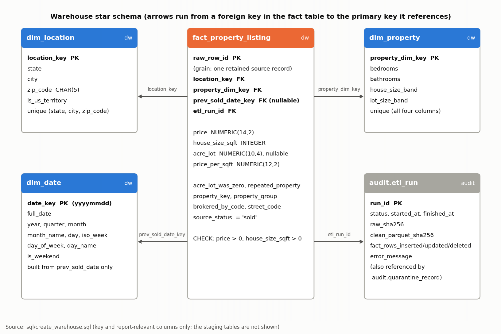

**Figure 2.** The warehouse star schema, drawn from `sql/create_warehouse.sql`: one fact table and three dimensions in the `dw` schema, plus
the `audit.etl_run` table that the fact table references. `audit.quarantine_record` also references `etl_run`; the staging tables are not
shown, and only key and report-relevant columns are listed (Appendix A has the full DDL for the `dw` tables).

<details>
<summary>The same schema as a Mermaid entity-relationship diagram (as documented in <code>reports/warehouse_schema.md</code>; renders on GitHub and in VS Code with a Mermaid extension)</summary>

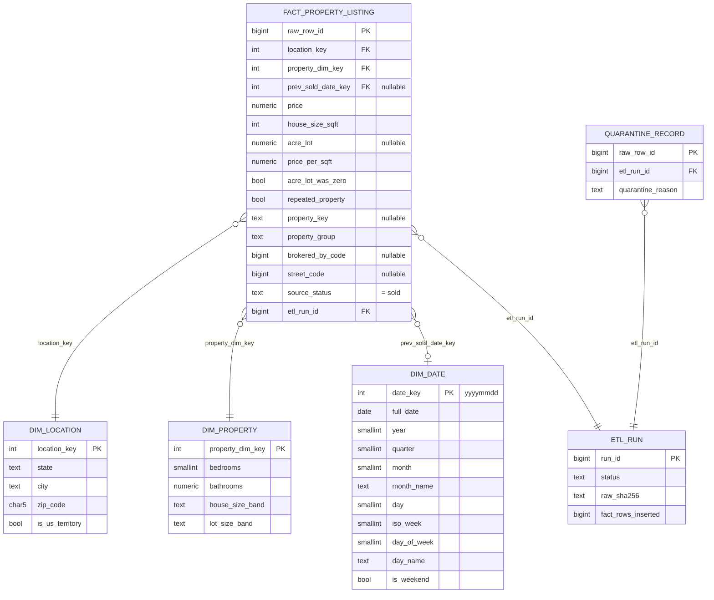

</details>

### 3.3 Fact table, grain, keys and dimensions

- **Fact table `dw.fact_property_listing`.** *Grain: one retained source record*: one row of the raw CSV with status `sold`
  that passed every cleaning rule. The primary key is `raw_row_id`, the row's 0-based position in the raw file. It holds
  the measures `price`, `house_size_sqft`, `acre_lot` and `price_per_sqft`, flags (`acre_lot_was_zero`,
  `repeated_property`), the property key and group used for leakage-safe splits, two anonymised source codes, and the ETL
  run that last wrote the row. It carries four foreign keys.
- **`dw.dim_location`.** One row per distinct `(state, city, zip_code)`; the ZIP is `CHAR(5)` with a format check, and
  `is_us_territory` is derived from the state.
- **`dw.dim_property`.** Low-cardinality descriptors: bedrooms, bathrooms and two *bands* (house size and lot size). Exact
  sizes stay on the fact table, because a dimension keyed on near-unique exact values would only duplicate it. The band
  edges are project choices (Appendix A).
- **`dw.dim_date`.** A calendar covering every day between the earliest and latest `prev_sold_date`. The fact table's
  foreign key is named `prev_sold_date_key`, and it is nullable (one record has no date). **It refers to the
  previous-sold-date field as recorded, not to a verified current sale date.**
- **Audit tables.** `audit.etl_run` records each load (status, timings, SHA-256 of the raw and processed files, rows
  inserted, updated and deleted, and any error), and `audit.quarantine_record` keeps the 704 quarantined rows with the
  rules each tripped.

Table 6 gives the sizes measured on the live server.

**Table 6. Warehouse table sizes (PostgreSQL 17.2, loaded 2026-10-27).**

| Table | Rows |
|---|---:|
| `dw.fact_property_listing` | 696,287 |
| `dw.dim_location` | 22,128 |
| `dw.dim_property` | 1,939 |
| `dw.dim_date` | 201 |
| `audit.quarantine_record` | 704 |

*Source: `reports/warehouse_etl.md` and `reports/warehouse_validation.json`. The database occupied 302 MB.*

### 3.4 Data types and constraints

Constraints enforce the cleaning rules in the database as a second line of defence: `price > 0`, `house_size_sqft > 0`,
`acre_lot > 0` when present, `bedrooms` between 1 and 20, `source_status = 'sold'`, a five-digit ZIP, and `NOT NULL` on every
required column. The type choices are `NUMERIC(14,2)` for price, `INTEGER` for house size, `NUMERIC(10,4)` for lot size and
`BIGINT` for the keys and codes. Appendix A reproduces the DDL.

### 3.5 ETL workflow

1. **Extract and clean.** `src/data_cleaning.py` reads the raw archive, standardises text and ZIP codes, applies the rules
   and writes the Parquet files and reports.
2. **Stage.** `src/warehouse_etl.py` streams the Parquet files into `staging.*` in batches of 100,000 rows with PostgreSQL
   `COPY`, so the data are never held in memory twice.
3. **Transform.** `sql/load_warehouse.sql` fills the calendar and the two dimensions, then *upserts* the fact rows (new rows
   inserted, existing rows updated only if a value differs), removes fact rows no longer in the snapshot, removes unreferenced
   dimension rows and refreshes the quarantine table.
4. **Audit and validate.** Counts are written to `audit.etl_run`, then a validation command runs the checks below.

Steps 2 to 4 run inside **one transaction**, so a failure rolls everything back. The audit row is written in a separate
committed transaction so that even a failed load is recorded.

### 3.6 Data-quality checks and the audit trail

The validator runs 52 checks: (i) row counts agree across the Parquet file, staging, the fact table, the quarantine table and
`reports/cleaning_summary.json`; (ii) the required fact columns are declared `NOT NULL` and contain no nulls; (iii) every
primary key and natural key is unique; (iv) all four foreign keys have no orphans, and no dimension row is unreferenced; (v)
every loaded column was compared row by row with staging (0 mismatches); (vi) total price, minimum, maximum, total house
size, count of known lot sizes and per-state counts and totals equal values recomputed independently in pandas from the
Parquet file; (vii) five *constraint probes* (a non-positive price, an unknown location key, a duplicate `raw_row_id`, a
non-sold status and a malformed ZIP) are each rejected by the database, inside a transaction that is always rolled back; and
(viii) the latest ETL run succeeded and its recorded hashes match the files on disk.

### 3.7 Idempotence and refresh

Rerunning the load on an unchanged snapshot changed nothing: the second run on the live server inserted, updated and
deleted 0 rows (`audit.etl_run`, run 2). On a temporary test cluster, a deliberately tampered warehouse (one price changed,
one row deleted, one stray row added) was repaired by a single load, and a load forced to fail by a temporary constraint
rolled back completely and was logged as `failed`. These stress tests were run on the temporary cluster only.

To refresh with new data, rerun the cleaning pipeline and the load command. One limitation applies: `raw_row_id` is a
*position*, so a re-downloaded file with a different row order would map different listings onto the same identifiers. A new
data version should be treated as a fresh snapshot, not an incremental update.

### 3.8 Validation results

The validation passed 52 of 52 checks on the temporary PostgreSQL 17.2 cluster used during development and again on the
local PostgreSQL 17.2 service, where it was loaded and validated on 2026-10-27 (`reports/warehouse_validation.md`).
Appendix B adds four analytical queries that were run against the live warehouse and cross-checked against the Parquet file.

---

## 4. Exploratory Data Analysis

All figures in this section are generated by `reports/figures/make_report_figures.py` from project files.

### 4.1 Price distribution

Recorded prices are strongly right-skewed (Figure 3). The cleaned sold records have a median of $364,999, a 5th percentile
of $105,000, a 95th percentile of $1,300,000 and a maximum of $80,000,000; their skewness is 19.4 on the dollar scale and
0.06 after taking logarithms, which motivates modelling the logarithm of price (Section 5).

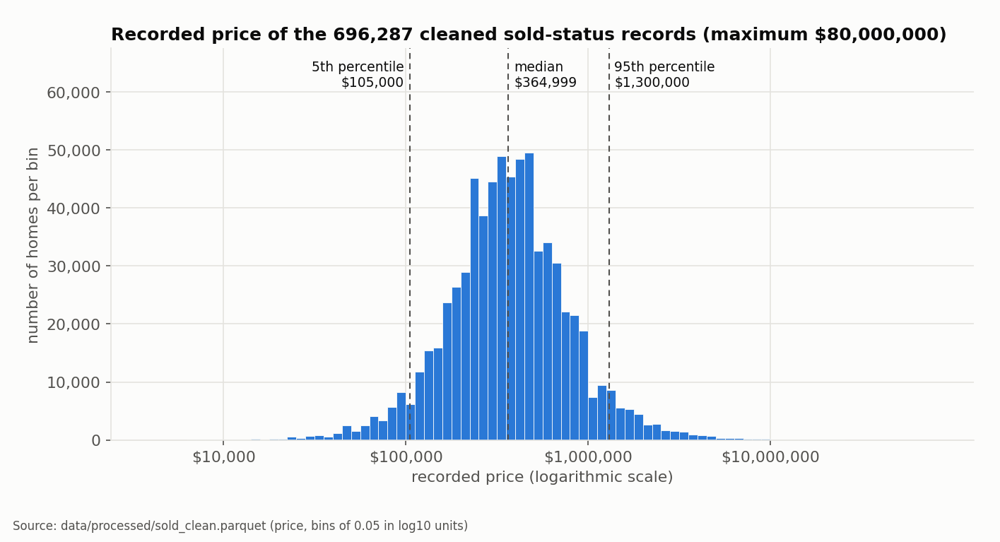

**Figure 3.** Recorded price of the 696,287 cleaned sold-status records on a logarithmic axis. *Source:
`data/processed/sold_clean.parquet`.*

**Table 7. Summary of the cleaned modelling dataset (n = 696,287; lot size is known for 608,298 rows).**

| Variable | Non-missing | Mean | Minimum | 5th pct | Median | 95th pct | Maximum |
|---|---:|---:|---:|---:|---:|---:|---:|
| `price` | 696,287 | $507,909 | $4,900 | $105,000 | $364,999 | $1,300,000 | $80,000,000 |
| `bed` | 696,287 | 3.18 | 1.00 | 2.00 | 3.00 | 5.00 | 20.00 |
| `bath` | 696,287 | 2.39 | 1.00 | 1.00 | 2.00 | 4.00 | 20.00 |
| `house_size` | 696,287 | 1,893.66 | 200.00 | 854.00 | 1,675.00 | 3,619.00 | 43,560.00 |
| `acre_lot` | 608,298 | 1.10 | 0.01 | 0.04 | 0.20 | 2.99 | 1,000.00 |
| `price_per_sqft` | 696,287 | 271.81 | 5.09 | 77.55 | 201.71 | 695.79 | 8,714.29 |

*Source: `reports/cleaning_clean_numeric_summary.csv`. House size is interpreted as square feet and lot size as acres.*

### 4.2 Geographic coverage

Coverage is very uneven (Figures 4 and 5, Table 8). The cleaned data cover 51 state-level values (states, the District of
Columbia, Puerto Rico and the Virgin Islands), but California, Texas and Florida alone hold 258,486 rows, and eight states
or territories have fewer than 100 rows (for example Vermont has 3). Guam has none. Of 16,090 cities, 3,378 have at least
30 rows and only 199 have at least 500 (Table 8).

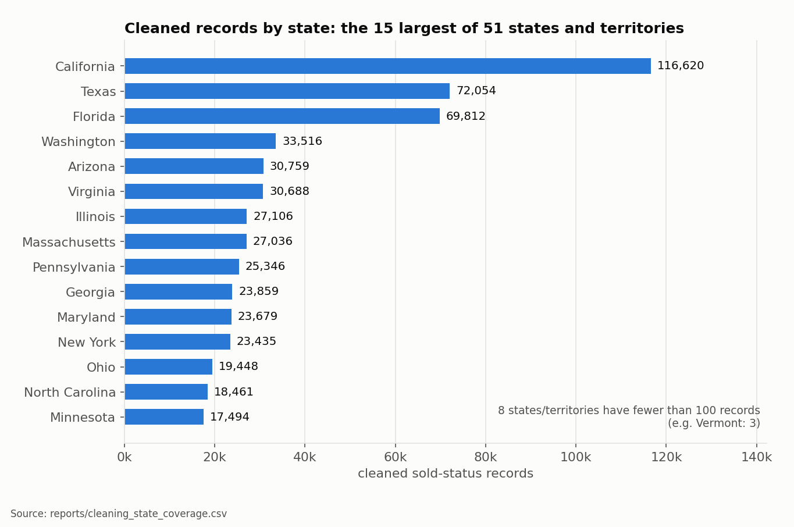

**Figure 4.** The 15 largest states by cleaned records. *Source: `reports/cleaning_state_coverage.csv`.*

**Table 8. City coverage of the cleaned data.**

| Minimum rows per city | Cities | Rows covered | Share of cleaned rows |
|---|---:|---:|---:|
| 1 | 16,090 | 696,287 | 100.0% |
| 10 | 6,169 | 665,525 | 95.6% |
| 30 | 3,378 | 617,647 | 88.7% |
| 100 | 1,417 | 509,995 | 73.2% |
| 500 | 199 | 260,534 | 37.4% |

*Source: `reports/cleaning_city_coverage_thresholds.csv`.*

Figure 5 shows typical recorded prices by state from warehouse query 1 (Appendix B). Medians range from $140,000 in Kansas
to $699,000 in California and the District of Columbia (tied). The state medians reflect both location and the mix of homes
sold, and for several states the mean is far above the median (New York: mean $554,199, median $254,900), another sign of a
long expensive tail.

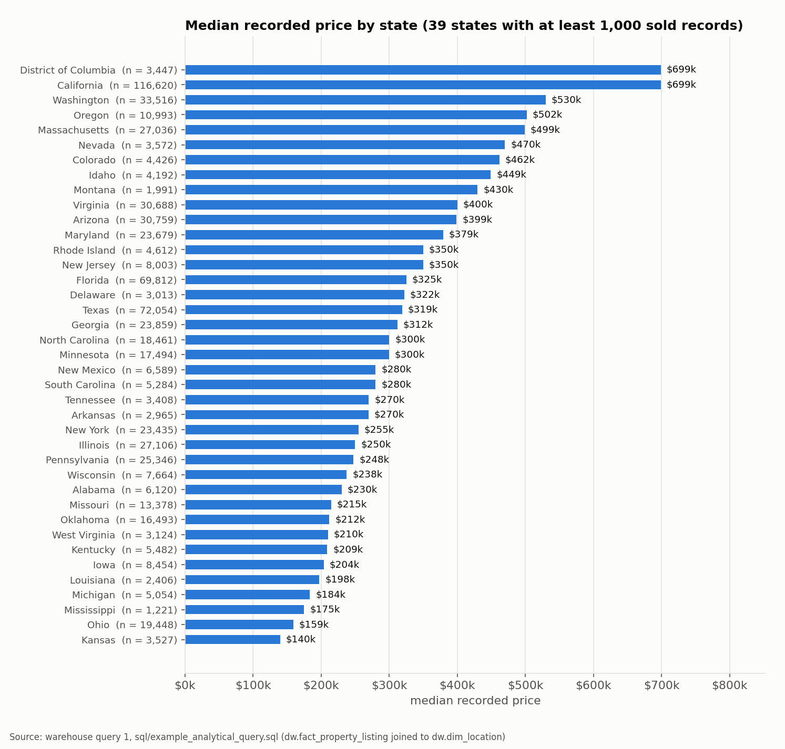

**Figure 5.** Median recorded price in the 39 states with at least 1,000 sold records, with the number of records. *Source:
warehouse query 1, `sql/example_analytical_query.sql`.*

### 4.3 Property characteristics

Typical homes have 3 bedrooms, 2 bathrooms and 1,675 square feet (medians); the median price per square foot is $201.71.
Warehouse query 2 shows the expected pattern: the median recorded price rises from $209,900 for homes under 1,000 square
feet to $995,000 for homes of 4,000 square feet or more, while the median price per square foot falls from $255 to about
$189 before rising again for the largest homes (Appendix B).

### 4.4 Time coverage

Every cleaned record except one has a `prev_sold_date`, and they fall between 2021-10-18 and 2022-05-06 (215,400 in 2021 and
480,886 in 2022). Warehouse query 4 (Appendix B) shows that October 2021 (13,124 records) and May 2022 (6,759) are partial
months and that March and April 2022 are the largest (142,010 and 157,250). The data therefore describe **a single seven-month
window**, and the model cannot learn about price trends over time. Whether this date is the sale date remains unverified.

### 4.5 Repeated properties

Because no listing identifier exists, repeated sales of one property can only be approximated through `(street, zip_code)`.
Among the cleaned rows, 1,752 have no key, only 196 keys occur more than once (474 rows; at most 11 rows for a key), and in 134
of those 196 the rows differ in bedrooms, bathrooms or size, so the key sometimes joins different units. In addition, 2,806
street codes appear under more than one ZIP. The key is thus imperfect: it can merge distinct units but cannot link the same
home listed under a missing or different key. Repeated sold properties are rare, so the leakage risk it controls is small
but not zero.

### 4.6 Implications for modelling

The EDA led to these decisions: model the logarithm of price; evaluate with a split that keeps each property together; treat
geographic coverage as part of the problem (some places cannot be predicted reliably); avoid time-based claims; and report
errors in percentage terms as well as dollars, because a $100,000 error means very different things for a $150,000 home and a
$2,000,000 home.

---

## 5. Machine-Learning Methodology

### 5.1 Target and features

The target is the recorded price in dollars. Features are the state, the city, bedrooms, bathrooms, the logarithm of house
size, the logarithm of lot size, and four missing-value indicators. Excluded on purpose were: `price_per_sqft` (derived from
the target); the previous-sold date and its year (meaning unverified); the street, broker and row-id codes (identifiers that
encourage memorisation); and the ZIP code in the baseline (it is added only in the hybrid model, Section 5.6).

### 5.2 Splitting strategy and leakage safeguards

Each row's `property_group` (its `(street, zip_code)` key, or a singleton for rows without one) is hashed with a fixed seed to
a number in [0, 1), and the number decides the split. All rows of a property therefore fall in one split, regardless of the
dataset's size or order, and the assignment is stable when the data are rebuilt. The split sizes are in Table 9. A test
asserts that no property group crosses splits.

**Table 9. Group-aware split of the 696,287 cleaned rows (seed 42).**

| Split | Rows | Share | Property groups | Rows without a property key | Distinct cities |
|---|---:|---:|---:|---:|---:|
| train | 418,165 | 60.1% | 418,011 | 1,082 | 14,242 |
| validation | 69,769 | 10.0% | 69,730 | 181 | 8,165 |
| calibration | 69,253 | 9.9% | 69,217 | 186 | 8,179 |
| test | 139,100 | 20.0% | 139,051 | 303 | 10,486 |

*Source: `reports/experiment_summary.json`.*

Each split has a role, and the roles were kept separate:

| Split | Role |
|---|---|
| Train (60%) | Fit all models and all learned preprocessing |
| Validation (10%) | Select the model, compare variants, set the location-support policy, fit the spread model for the ranges |
| Calibration (10%) | Set the width multipliers of the prediction ranges, and nothing else |
| Test (20%) | Report final performance |

Other leakage safeguards: every learned transformation (imputation, scaling and location encoding) is fitted on training rows
inside the modelling pipeline; the location encoding is *cross-fitted* so that no training row's own price enters its own
feature (Section 5.3); and features computed from the target are excluded. **Limitations of the grouping** are those of the
key (Section 4.5): rows without a key are treated as independent, and the key is imperfect.

### 5.3 Location encoding

City and state have too many categories for one-hot encoding. A *hierarchical target encoder* summarises each location as a
shrunken average of training prices (Micci-Barreca, 2001): a state's value is shrunk toward the global mean, and a city's value is
shrunk toward its state's value, with prior strengths of 20 and 10 observations. A city never seen in training therefore
falls back to its state. The averages are computed on prices after removing the linear effect of house size, bedrooms and
bathrooms. This **size adjustment** was introduced after the first full run showed a systematic bias: median log residuals of
+0.19 for Florida in every split, against about 0.00 elsewhere. The cause was that Florida and Texas have the same unconditional
mean log price (12.697), so an unadjusted state average could not tell them apart. In a validation-only comparison the adjustment
lowered MAE from $115,785 to $106,871 and removed the Florida bias (Table D1 in Appendix D).

### 5.4 Models and selection

Five candidates were compared on the same split and features (Friedman, 2001; Breiman, 2001; Hoerl & Kennard, 1970;
Pedregosa et al., 2011): (1) a baseline that always predicts the training median price; (2) ridge regression on log price; (3) a
random forest on log price (100 trees); (4) histogram gradient boosting on log price; and (5) histogram gradient boosting on the raw
price. The histogram implementation in scikit-learn is inspired by LightGBM and supports missing values natively (scikit-learn
developers, n.d.). Predictions are converted back to dollars and floored at $1 before any metric is computed. The model was
**selected by validation MAE**, and the test split was scored afterwards for every
candidate. The selected model, "v1", is gradient boosting on log price with at most 1,000 iterations (765 were used after early
stopping), a learning rate of 0.1, 63 leaves per tree, at least 50 rows per leaf and L2 regularisation of 1.0. In a validation-only check,
raising capacity (up to 1,500 iterations and 127 leaves) changed MAE by under 0.5%, so accuracy was limited by the information in the
features, not by model capacity.

### 5.5 Evaluation metrics

All metrics are computed in dollars on held-out rows. **MAE** is the average absolute error. **RMSE** is the square root of the
average squared error and penalises large errors, so it is dominated by expensive homes. **R²** is the share of price variance
explained. The **median absolute error** and the **median absolute percentage error** (the typical error as a share of the recorded
price) describe a typical home and are robust to extreme values. **Coverage** is the share of homes whose recorded price falls
inside their prediction range, and the **range width** is how wide that range is.

### 5.6 The ZIP hybrid model

The plain model knows only the city. To test whether neighbourhood detail helps, the encoder gained a third level (state, then
city, then ZIP) with the same size adjustment and cross-fitting. The decision rule was written *before* any result was seen: a
candidate had to lower validation MAE by at least 2% **and** not worsen median percentage error by more than one point on whole
cities held out of training or on whole ZIP codes held out inside seen cities. Three candidates were tested on the validation
split (Tables 15 and 16): the plain ZIP model, a ZIP model trained with the ZIP hidden on a random 20% of rows ("dropout"), and a
**hybrid** that uses the ZIP model only for ZIP codes with at least five training rows, and the original city-level model otherwise.
The plain ZIP model gave the best ordinary accuracy but failed the rule on unseen ZIP codes (median error +6.7 points). A likely
explanation, consistent with the dropout result but not proven, is that in training a missing ZIP signal occurred only for tiny ZIP
codes, so the model misapplied it to new ZIP codes. The hybrid and the dropout model passed, and the hybrid had the lowest validation
MAE among passing candidates, so it was the only candidate evaluated on the test split, once. Missing, invalid and rare ZIP codes use
the city-level model by design.

### 5.7 Prediction intervals

Ranges use **split conformal prediction** on the logarithm of price (Lei et al., 2018; Angelopoulos & Bates, 2023). A small
gradient-boosting model, fitted on the validation split, predicts how large the log-error of a home is likely to be (its "spread").
On the calibration split, the quantile of the absolute log-error divided by the spread gives a multiplier for each level. A home's range is
the estimate times e to the power of plus or minus (multiplier × spread). The multipliers are 1.543 (80%) and 2.105 (90%) for the
city-level model, 1.552 and 2.099 for ZIP-level estimates, and 1.575 and 2.192 for ZIP codes that fall back to the city-level model,
calibrated on 69,253 rows (66,546 on the ZIP route and 2,707 on the fallback route). Letting the width vary with the home keeps
coverage close to nominal across the predicted-price range, whereas a constant-width alternative did not (coverage of 61% in the cheapest
predicted-price decile against a nominal 80%, Appendix D). The guarantee of conformal prediction is
*marginal*: on average over exchangeable data, not for a particular home, city or price band, and it can fail under distribution shift.

### 5.8 Location-support policy

A location is a (state, city) pair. It is **supported** if it has at least 100 training rows, at least 10 validation rows and a
validation median error of at most 25%; **limited** if it has at least 30 training rows but fails a supported criterion; and
**unsupported** otherwise. No estimate is given for unsupported or unseen cities. The policy uses error as well as row count because
sample size alone did not predict accuracy: validation median error was *higher* for cities with at least 500 training rows (16.4%) than
for those with at least 100 (14.1%), as the largest cities contain very mixed neighbourhoods. For the hybrid system the error used is
the worse of the no-ZIP and with-ZIP paths, so a city is supported only if both are reliable. All evidence comes from the validation
split, not the test split.

### 5.9 Limitations of the method

The grouping key is imperfect; the location policy and thresholds are project choices; the encoder and the spread model are
additional learned components whose behaviour was checked only empirically; and performance for cities and ZIP codes the model has
not seen is much weaker (Section 6.5).

---

## 6. Experimental Results and Evaluation

All results are on held-out rows. "Test" figures were computed on 139,100 test homes. Results describe this dataset and this
seven-month window and do not guarantee future performance.

### 6.1 Model comparison

| Model | Val. MAE | Val. R² | Val. median % error | Test MAE | Test RMSE | Test R² | Test median % error | Fit time (s) | Saved size (MB) |
|---|---:|---:|---:|---:|---:|---:|---:|---:|---:|
| Median-price baseline | $280,877 | -0.044 | 43.8% | $282,014 | $712,215 | -0.041 | 43.8% | 0.0 | 0.0 |
| Ridge regression (log price) | $125,266 | 0.632 | 17.6% | $124,699 | $424,927 | 0.629 | 17.5% | 1.6 | 0.6 |
| Random forest (log price) | $111,237 | 0.680 | 15.2% | $111,134 | $424,167 | 0.631 | 15.1% | 15.4 | 60.5 |
| **Gradient boosting (log price) = v1, selected** | $106,871 | 0.730 | 14.8% | $106,982 | $383,269 | 0.699 | 14.9% | 13.2 | 6.2 |
| Gradient boosting (raw price) | $113,767 | 0.720 | 15.7% | $113,117 | $381,184 | 0.702 | 15.7% | 4.6 | 2.2 |

**Table 10.** Candidate models. Validation figures drove the selection; test figures are reported afterwards. *Source:
`reports/experiment_summary.json`.*

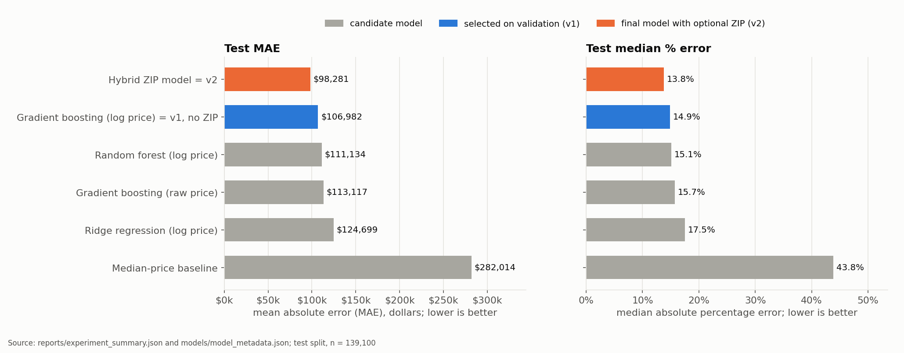

**Figure 6.** Test MAE (left) and median percentage error (right) for the candidates, the selected v1 model and the final hybrid.
*Source: `reports/experiment_summary.json`, `models/model_metadata.json`.*

Gradient boosting on log price was the most accurate candidate on validation, so it was selected. Taking logarithms mattered: the same
boosting model on raw prices had a test MAE of $113,117 against $106,982. A simple median baseline had a test MAE of $282,014, so
the models explain much of the variation even though a typical error is still 15%.

### 6.2 Final system: hybrid ZIP model versus the no-ZIP model

| Metric | No ZIP (v1) | With ZIP (hybrid, v2) | Change |
|---|---:|---:|---:|
| Test homes | 139,100 | 139,100 |  |
| MAE | $106,982 | $98,281 | -8.1% |
| RMSE | $383,269 | $352,288 | -8.1% |
| R² | 0.699 | 0.745 | +0.047 |
| Median absolute error | $51,125 | $47,738 | -6.6% |
| Median absolute % error | 14.9% | 13.8% | -1.1 pts |
| 80% range coverage (nominal 80%) | 80.1% | 80.4% |  |
| 90% range coverage (nominal 90%) | 90.2% | 90.2% |  |
| Median width of the 80% range | $199,508 | $187,711 | -5.9% |
| Median width of the 90% range | $276,286 | $257,391 | -6.8% |

**Table 11.** Test results (n = 139,100). "No ZIP" is the v1 model with its v1 ranges. "With ZIP" is the hybrid evaluated with each
home's own ZIP. *Source: `models/model_metadata.json`, `reports/zip_feature_experiment.md`.*

The hybrid lowered the test MAE by 8.1% (from $106,982 to $98,281), lowered the RMSE by 8.1% and raised R² from 0.699 to 0.745. Its
median percentage error fell from 14.9% to 13.8%. Its ranges were also slightly narrower at the same coverage (median 80% range
$187,711 against $199,508). In plain terms, for a typical home the estimate is off by about 14% of the recorded price, and the hybrid
explains roughly three-quarters of the variation in recorded prices. The hybrid applies only where a ZIP is supplied and has at least five
training records; otherwise the v1 prediction is used unchanged.

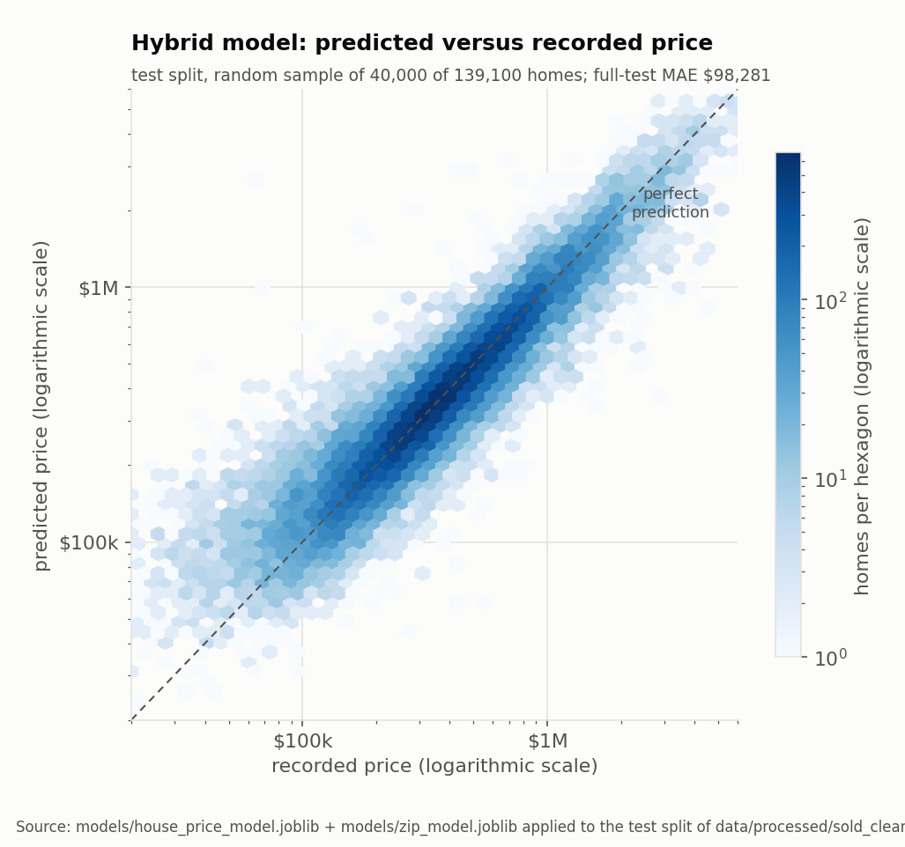

**Figure 7.** Predicted versus recorded price for the hybrid model (random sample of 40,000 test homes; the full-test MAE
reproduced from the stored model is $98,281). Points on the dashed line would be perfect predictions. *Source: stored models applied to
the test split.*

The scatter widens at low prices and the model tends to over-predict the cheapest homes and under-predict the most expensive ones,
a common regression-to-the-mean pattern, visible in the subgroup results below.

### 6.3 Performance by price band

| Recorded price | Homes | MAE no ZIP | MAE with ZIP | Median % err. no ZIP | Median % err. with ZIP | 80% cov. no ZIP | 80% cov. with ZIP | 90% cov. no ZIP | 90% cov. with ZIP |
|---|---:|---:|---:|---:|---:|---:|---:|---:|---:|
| under $100k | 6,810 | $55,191 | $51,248 | 58.1% | 50.4% | 54.6% | 57.2% | 66.8% | 68.6% |
| $100-200k | 21,118 | $44,163 | $41,423 | 19.3% | 18.0% | 80.6% | 80.6% | 89.3% | 89.0% |
| $200-400k | 51,504 | $52,862 | $49,504 | 13.3% | 12.4% | 84.4% | 84.2% | 94.0% | 93.5% |
| $400-700k | 36,176 | $87,936 | $80,771 | 12.5% | 11.5% | 81.6% | 81.7% | 92.0% | 91.9% |
| $700k-1M | 12,624 | $154,187 | $141,316 | 14.0% | 12.9% | 78.9% | 79.3% | 90.0% | 90.3% |
| $1-2M | 8,219 | $312,672 | $282,402 | 18.1% | 15.9% | 72.5% | 74.5% | 84.6% | 85.5% |
| over $2M | 2,649 | $1,190,141 | $1,083,612 | 25.5% | 21.3% | 66.4% | 70.3% | 78.6% | 81.0% |

**Table 12.** Test results by recorded-price band. Coverage columns are the share of homes inside their 80% and 90% ranges. *Source:
`reports/zip_experiment_validation.json`, `models/model_metadata.json`.*

Both systems are most accurate for homes of $200,000 to $700,000 (median error 12.5% to 13.3% without ZIP, 11.5% to 12.4% with it) and least accurate at the extremes:
homes recorded under $100,000 have a median error of 58.1% without ZIP (50.4% with it), and homes over $2 million have a median error
of 25.5% (21.3%). The hybrid improved every band.

### 6.4 Prediction-interval coverage

Overall, the ranges behaved as intended: 80.1% and 90.2% of test homes fell inside the 80% and 90% ranges without a ZIP, and 80.4% and
90.2% with one (Table 11). Coverage by recorded-price band (Figure 8, Table 12) shows the **weakness at the extremes**: the 80% range
contained only 54.6% of homes recorded under $100,000 without ZIP (57.2% with ZIP), 72.5% of those at $1 to $2 million (74.5%) and 66.4%
of those over $2 million (70.3%). These bands are defined by the recorded price itself, so a drift is expected: a home whose price is
unusually low *for its features* is more likely to be recorded in the lowest band. Coverage by *predicted* price was close to nominal
(80% range: 78.3% to 80.9% across predicted-price deciles in the v1 model, Appendix D), which is the quantity a user can see in advance.
Coverage by location status was 81.0% in supported cities, 79.1% in limited ones and 80.5% in unsupported ones for the hybrid (80% level),
and for the ZIP route it was 80.5% on the ZIP model and 78.9% on the city-level fallback (Table 13).

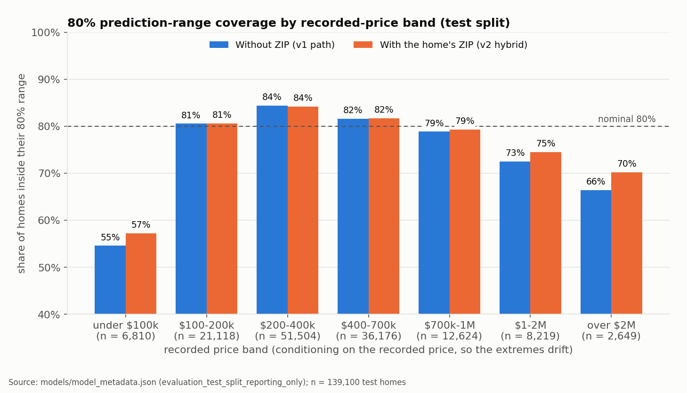

**Figure 8.** 80% range coverage by recorded-price band. *Source: `models/model_metadata.json`.*

| Group | Homes | 80% cov. no ZIP | 80% cov. with ZIP | 90% cov. no ZIP | 90% cov. with ZIP |
|---|---:|---:|---:|---:|---:|
| Location status: supported | 79,604 | 80.6% | 81.0% | 90.7% | 90.6% |
| Location status: limited | 36,086 | 78.9% | 79.1% | 89.3% | 89.2% |
| Location status: unsupported | 23,410 | 80.2% | 80.5% | 89.9% | 90.2% |
| ZIP route: ZIP model | 133,616 | n/a | 80.5% | n/a | 90.2% |
| ZIP route: city-level fallback | 5,484 | n/a | 78.9% | n/a | 89.0% |

**Table 13.** Test coverage of the 80% and 90% ranges by location status (v2 statuses) and, for the hybrid, by ZIP route.

### 6.5 Generalisation to unseen cities and ZIP codes

To measure how the v1 model behaves where it has no local training data, 2,341 cities (15%) were held out of training entirely and the
model was retrained without them.

| Evaluation | City size (rows) | Homes | MAE | Median abs. error | Median % error | R² |
|---|---|---:|---:|---:|---:|---:|
| held-out cities (never seen) | all | 86,139 | $211,408 | $102,583 | 33.3% | 0.436 |
| held-out cities (never seen) | <30 | 11,145 | $162,815 | $76,613 | 31.9% | 0.377 |
| held-out cities (never seen) | 30-99 | 16,165 | $208,673 | $96,849 | 31.4% | 0.404 |
| held-out cities (never seen) | 100-499 | 35,079 | $247,035 | $111,556 | 32.8% | 0.455 |
| held-out cities (never seen) | 500+ | 23,750 | $183,451 | $109,094 | 36.1% | 0.404 |
| seen cities (test split) | all | 121,948 | $109,058 | $51,692 | 15.0% | 0.669 |
| seen cities (test split) | <30 | 13,523 | $112,964 | $54,131 | 21.6% | 0.582 |
| seen cities (test split) | 30-99 | 18,283 | $97,536 | $47,947 | 15.3% | 0.755 |
| seen cities (test split) | 100-499 | 43,089 | $100,313 | $48,931 | 13.3% | 0.803 |
| seen cities (test split) | 500+ | 47,053 | $120,420 | $55,543 | 15.1% | 0.585 |

**Table 14.** The v1 model on held-out cities versus cities seen in training. *Source: `reports/experiment_summary.json`.*

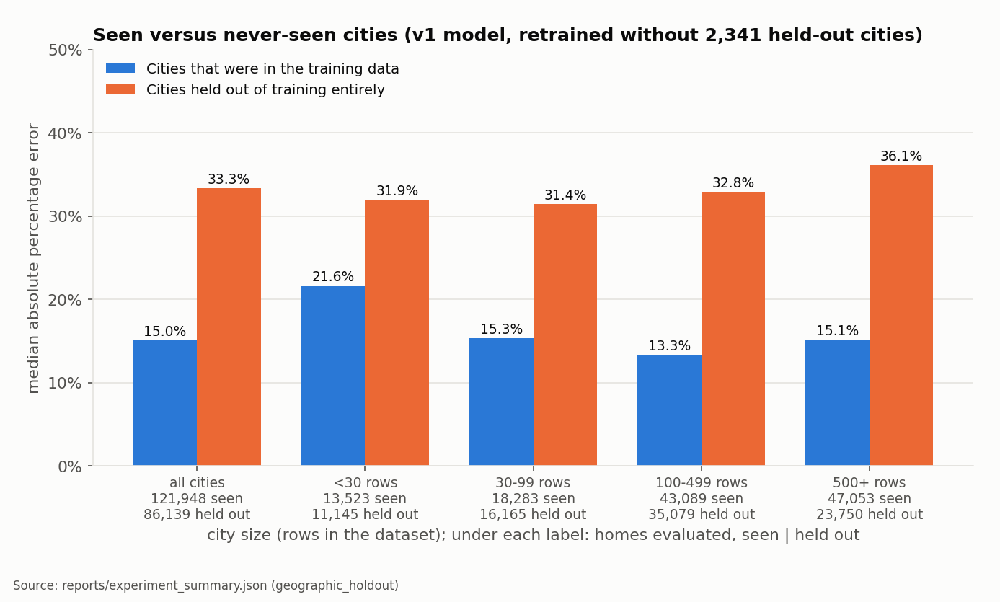

**Figure 9.** Median percentage error for seen and never-seen cities by city size. *Source: `reports/experiment_summary.json`.*

For never-seen cities the median error was 33.3% (R² 0.44), more than twice the 15.0% for seen cities (R² 0.67), and this held in every
city-size group. For this reason the application gives **no fallback estimate** for cities outside the supported or limited lists. The ZIP
experiment gave a comparable picture on its validation data: for whole cities held out, the hybrid's median error was 30.1% against 32.8%
for the no-ZIP model, and for whole ZIP codes held out inside seen cities it was 16.3% against 16.4%, so ZIP information did not degrade
generalisation:

| Held out | Model | Homes | MAE | Median % error | R² |
|---|---|---:|---:|---:|---:|
| unseen cities | baseline | 8,562 | $206,681 | 32.8% | 0.381 |
| unseen cities | zip | 8,562 | $197,848 | 30.4% | 0.373 |
| unseen cities | zip_dropout | 8,562 | $201,569 | 31.4% | 0.381 |
| unseen cities | hybrid | 8,562 | $197,585 | 30.1% | 0.391 |
| unseen ZIPs in seen cities | baseline | 5,579 | $120,482 | 16.4% | 0.742 |
| unseen ZIPs in seen cities | zip | 5,579 | $149,186 | 23.1% | 0.652 |
| unseen ZIPs in seen cities | zip_dropout | 5,579 | $122,135 | 17.0% | 0.736 |
| unseen ZIPs in seen cities | hybrid | 5,579 | $119,985 | 16.3% | 0.742 |

**Table 15.** Validation-split generalisation checks of the ZIP candidates. *Source: `reports/zip_experiment_validation.json`.*

| Model | Validation MAE | RMSE | R² | Median abs. error | Median % error |
|---|---:|---:|---:|---:|---:|
| baseline | $106,871 | $346,754 | 0.730 | $50,899 | 14.8% |
| zip | $98,707 | $335,139 | 0.748 | $47,451 | 13.8% |
| zip_dropout | $99,349 | $337,511 | 0.744 | $47,526 | 13.9% |
| hybrid | $98,775 | $336,412 | 0.746 | $47,476 | 13.8% |

| Candidate | Validation MAE gain (needs ≥ 2%) | Unseen-city error change (needs ≤ +1.0 pt) | Unseen-ZIP error change (needs ≤ +1.0 pt) | Passes |
|---|---:|---:|---:|---:|
| zip | 7.6% | -2.4 pts | +6.7 pts | no |
| zip_dropout | 7.0% | -1.4 pts | +0.6 pts | yes |
| hybrid | 7.6% | -2.7 pts | -0.1 pts | yes |

**Table 16.** Validation results of the ZIP candidates and the pre-registered decision checks. *Source:
`reports/zip_experiment_validation.json`.*

On the test split, homes whose ZIP had at least five training records (133,616 of 139,100) improved from a median error of 14.6% to 13.5%,
while the 5,484 homes with rare or unseen ZIP codes (4,324 with one to four training rows, 1,160 with none) kept the v1 error (25.5% and
31.9%), as designed. These rarer ZIP codes are much harder to predict: ZIP information helps where it is plentiful and cannot be conjured
where it is missing.

### 6.6 Missing-data experiment

To test whether the 114,401 sold rows with missing basic characteristics could add value, the model was trained with and without them (using
median imputation fitted on training rows, with missing-value indicators).

| Training | Evaluated on (test split) | Homes | MAE | R² | Median % error |
|---|---|---:|---:|---:|---:|
| A complete-case training | complete-case rows | 139,100 | $106,982 | 0.699 | 14.9% |
| A complete-case training | incomplete rows, house_size missing | 20,533 | $257,528 | 0.126 | 90.4% |
| A complete-case training | incomplete rows, only bed/bath missing | 2,156 | $219,597 | 0.654 | 28.7% |
| B + imputed incomplete rows | complete-case rows | 139,100 | $108,581 | 0.704 | 15.3% |
| B + imputed incomplete rows | incomplete rows, house_size missing | 20,533 | $129,236 | 0.356 | 33.1% |
| B + imputed incomplete rows | incomplete rows, only bed/bath missing | 2,156 | $182,979 | 0.765 | 24.9% |

**Table 17.** Test results (v1 boosting model). Row A is trained on complete cases only; row B adds the incomplete training rows. *Source:
`reports/experiment_summary.json`.*

Adding the incomplete rows did **not** improve accuracy on complete-case homes (MAE $108,581 against $106,982). The incomplete rows themselves
could be predicted only poorly: median error 33.1% where house size is missing and 24.9% where only bedrooms or bathrooms are missing,
against 14.9% for complete homes. The application therefore requires bedrooms, bathrooms and house size and never imputes them.

### 6.7 Location support

| Status (v2) | Cities | Cleaned rows |
|---|---:|---:|
| limited | 1,665 | 180,864 |
| supported | 770 | 400,065 |
| unsupported | 13,655 | 115,358 |

| Status under v1 | Status under v2 | Cities |
|---|---|---:|
| limited | limited | 1,633 |
| limited | supported | 10 |
| supported | limited | 32 |
| supported | supported | 760 |
| unsupported | unsupported | 13,655 |

**Table 18.** Location-support classification of the 16,090 cities (v2 policy, validation evidence) and its change from the first policy (v1).
*Source: `models/model_metadata.json`, `reports/zip_integration.json`.*

Of the 2,435 cities offered, 770 are supported and 1,665 have limited coverage. 13,655 cities, covering 115,358 cleaned rows, are unsupported.
11 of the 51 states and territories that have a location entry have no supported city (Connecticut, Hawaii, Indiana, Nebraska, New Hampshire, North Dakota, Puerto Rico, South Dakota, Vermont, Virgin Islands, Wyoming), and
9 have no city offered at all (Connecticut, Indiana, Nebraska, New Hampshire, North Dakota, South Dakota, Vermont, Virgin Islands, Wyoming). Many large cities are unsupported simply because the dataset holds few complete sold records for them
(for example Columbus, Ohio has 3).

### 6.8 Transparency about use of the test set

The test split was **not** held back perfectly. It was evaluated in two full runs of the modelling pipeline, once in the ZIP experiment's test
stage, in every run of the integration script (which reports test coverage and was rerun several times), and in scripts used to
verify and plot results. The Florida bias (Section 5.3) was first noticed in the by-state test table of the first full run, so the test
split had been viewed before the encoder was changed. The change itself was designed and chosen using training and validation residuals and
validation metrics only, and no test-derived quantity was used to select a model, tune a hyper-parameter, set the width of the ranges or
define the location-support policy. Nevertheless, because the test split has been inspected repeatedly, the reported test figures should be read
as optimistic estimates, and a fresh hold-out set, preferably from a later period, would be needed to confirm them.

---

## 7. Application Design and Implementation

### 7.1 Overview

The application, branded **HomeValue AI**, is a Streamlit app (`app/streamlit_app.py`, with local styling in `app/styles.css`) (Snowflake Inc.,
2026). It reads only the saved model files in `models/`; it needs no database connection at run time and never retrains. Every estimate is
produced by `src/predict.py`, which enforces the location policy and input validation. Evaluation figures shown to users are read from
`models/model_metadata.json`, so they always describe the installed model version (2.0.0-zip-hybrid).

### 7.2 Inputs and validation

| Input | Rule |
|---|---|
| State or territory | Shown beside the city selector; only states with at least one supported or limited city are listed |
| City | Filtered by state from `models/location_support.csv`; limited cities are labelled; changing the state clears the city |
| ZIP code (optional) | Only ZIP codes recorded for the chosen city are listed, as five-character text with leading zeros kept; changing the city clears it |
| Bedrooms | Whole number from 1 to 20 |
| Bathrooms | 1 to 20; fractions raise a warning, because the training data contain whole numbers only |
| House size | 200 to 50,000 square feet; unusual sizes raise a warning |
| Lot size | Optional; shown only after ticking "Include lot size"; above 0 and at most 1,000 acres |

Inputs are checked twice: a light check in the app and the authoritative check in the prediction module, which rejects booleans, text,
non-finite numbers and out-of-range values.

### 7.3 Prediction flow, ZIP handling and fallback

Pressing **Estimate Home Value** (a **Reset** button clears the form) calls the prediction function twice, for the 80% and 90% ranges, and the app verifies that both agree on
the estimate and that each range is finite and ordered; otherwise it shows a generic error and **no number**. Without a ZIP the v1 model and its ranges are
used unchanged. With a ZIP, the module checks that the ZIP is five digits and recorded with the chosen state and city in the dataset-derived
ZIP-city table, **rejecting mismatches without substituting another location**. A ZIP with at least five training records uses the ZIP model;
a ZIP with fewer records uses the city-level estimate with the ZIP-route calibration, and the app tells the user so. The ZIP-city table is
dataset-derived and was not independently verified, so a wrong but listed ZIP produces a confidently wrong ZIP-level estimate (Section 9).

### 7.4 Location policy in the interface

Unsupported cities are never offered, so they cannot receive an estimate. Limited cities are labelled in the list and carry a prominent
warning that states the stored reason and the weaker testing coverage. A "Check a city" tool inside the "Location coverage" section explains any city's status
without producing an estimate.

### 7.5 Presentation of results and caveats

A result, labelled "Estimated Home Value", shows the estimated recorded price rounded to the nearest $1,000, a range bar, and the 80% and 90% ranges rounded *outward* to whole
thousands, so a displayed range is never narrower than the calibrated one. Beside them the app states the tested coverage as an
average over many homes, not a guarantee for the property; shows the location status and the model used (city-level, ZIP-level or
fallback); adds a caution when the estimate is under $150,000 or at least $1,000,000, quoting the weaker tested coverage in those ranges; and
adds a short note under the result ("Based on historical recorded prices (Oct 2021 - May 2022). Not an appraisal or a guaranteed current market value."). Three collapsed
expanders ("About this estimate", "Location coverage" and "Model limitations") explain how the estimate is made, how to read the ranges, how cities and ZIP codes are handled and the
model's limitations; the full disclosure appears once, in the first expander.


**Figure 10.** The final interface at 1366 px: estimate, range bar and ranges for a supported city without a ZIP (Houston, Texas; 3 bed, 2 bath,
1,800 sq ft). *Source: `reports/figures/app_screenshots/`, captured 2026-10-28.*

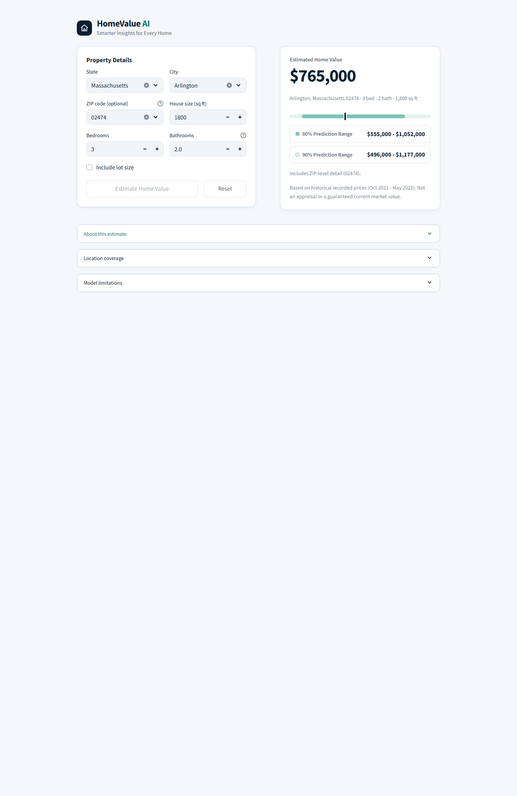

**Figure 11.** A ZIP-level estimate with a leading-zero ZIP (02474, Arlington, Massachusetts).

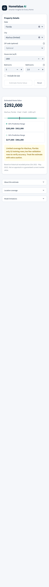

**Figure 12.** A limited-coverage city (Alachua, Florida) on a 390 px-wide screen, labelled "(limited)" in the city list, with the coverage warning shown below the result.

### 7.6 Error handling

If the model files cannot be loaded, the app shows only a friendly message and no form. If a prediction fails or returns an inconsistent
result, it shows a generic message and no price. Internal details are written to the server log only, and `showErrorDetails = false` hides Python tracebacks.
No file path, credential or internal name is shown to users (verified, Section 8.3).

---

## 8. Testing and Validation

### 8.1 Automated tests

The command `python -m pytest tests -q -p no:warnings` run on 2026-10-28 gave **138 passed, 0 failed, 0 skipped**.

| Suite | Tests | Passed |
|---|---:|---:|
| `tests/test_model_pipeline.py` (model pipeline) | 37 | 37 |
| `tests/test_streamlit_app.py` (application) | 34 | 34 |
| `tests/test_zip_experiment.py` (ZIP experiment) | 34 | 34 |
| `tests/test_zip_integration.py` (ZIP integration, rollback) | 33 | 33 |
| **Total** | **138** | **138** |

**Table 19.** Automated test suites. The model-pipeline tests cover leakage controls (no target-derived features, groups never crossing splits),
equality of single-request and batch predictions, and rejection of invalid or extreme inputs. The ZIP tests cover normalisation and leading zeros,
encoder fallback and cross-fitting, ZIP-city consistency, rare-ZIP fallback, recomputation of the calibration multipliers from the calibration
split, location-policy consistency, v1-backup integrity, and unchanged no-ZIP results. The app tests drive the interface with Streamlit's
`AppTest` and cover startup, state and city consistency, limited and unsupported locations, both ranges, stale results, reset and safe failures.

### 8.2 Real-browser checks

A real-browser check with Playwright and Chromium (Microsoft, 2026) was run against the final interface (the served files' SHA-256 values
are recorded in the results file). **89 of 89 checks passed**: 56 at a desktop width of 1366 px and 33 at a mobile width of 390 px.

| Run | Viewport | Passed | Checks |
|---|---|---:|---:|
| Functional and layout checks | desktop 1366 | 56 | 56 |
| Functional and layout checks | mobile 390 | 33 | 33 |
| **Functional and layout checks, total** |  | **89** | **89** |
| Model-load failure page (controlled copy) | desktop 1366 | 7 | 7 |
| Model-load failure page (controlled copy) | mobile 390 | 4 | 4 |
| **Model-load failure page (controlled copy), total** |  | **11** | **11** |

**Table 20.** Real-browser checks. *Source: `reports/figures/app_screenshots/browser_check_results.json`.*

They covered branding, dropdown behaviour, clearing the city when the state changes, supported and limited labels, leading-zero ZIP codes,
the browser's inability to select a malformed or wrong-city ZIP, the rare-ZIP fallback, the v1 estimate and ranges without a ZIP, dollar signs, a
range bar and its 80% and 90% rows, the lot-size field appearing only when requested, a single disclosure with the three expanders collapsed by default, stale-result hiding, reset in the browser (not only in the app's state), horizontal overflow,
clipped controls and text size, and the absence of external network requests. The first run of this check on an earlier version found two defects
that the in-process tests could not see, and both were fixed: price ranges were rendered as mathematical formulas because Streamlit reads
`$...$` as LaTeX, and Reset left the previous state visible in the browser.

### 8.3 Controlled model-load failure

A temporary copy of the app was served with a deliberately corrupted model file (production files untouched). **11 of 11 checks passed** at both widths: the page
shows only the friendly message, no form or estimate, no traceback, path, secret or internal name, and no JavaScript errors, while the server log records the real error.

### 8.4 Rollback verification

The v1 model is preserved in `models/backups/v1_no_zip/` with a manifest of SHA-256 hashes. Following the documented steps in an isolated temporary
copy (the live `models/` folder was not touched) restored files matching the manifest; the test suite then gave **105 passed and 33 skipped**, the
skips being the v2-specific ZIP integration tests. The restored v1 reproduced its recorded test MAE ($106,982.27) and R² (0.698577) exactly, and
estimates and ranges for 400 requests (200 cities at two levels) were identical to the live no-ZIP path; six differed only in a status label because
of the policy change. The rolled-back ZIP-field behaviour is covered by the app tests in that copy. *Evidence note: an earlier 12-check browser run of the rolled-back app (on a previous
version of the interface) was not saved and is not relied on here.*

### 8.5 Scope and limits of the testing

Browser testing used **Chromium only** (desktop, and 390 px mobile emulation). Firefox, Safari and real phones were not tested, and colour contrast was
not measured, so no accessibility compliance is claimed. In the browser, malformed and wrong-city ZIP codes cannot be selected from the dropdown; their
rejection by the prediction code is covered by the automated tests. No load, security-penetration or usability study with real users was performed. On a
phone-width screen the three expanders open at full width and the range rows stack.

---

## 9. Limitations, Ethics, and Risks

- **Price semantics.** The target is the *recorded* price of sold-status records, not an independently verified completed-sale price. The definition of the
  field and of `prev_sold_date` could not be confirmed, and the meaning of the date for sold rows is an inference.
- **Historical, narrow window.** All records fall within about seven months (October 2021 to May 2022), with partial first and last months. The model cannot
  represent trends and its estimates may differ substantially from current market values.
- **Complete-case selection bias.** Only 31.3% of raw rows, and 85.8% of sold rows that passed the location checks, are used; the rest lack basic
  characteristics or failed quality rules. Missingness is probably not random.
- **Dataset-derived, unverified mappings.** State and ZIP consistency and the ZIP-to-city table come from the dataset itself, not from an official source. A
  dataset error can be accepted as valid; a real but unlisted ZIP is rejected.
- **Imperfect property grouping.** The `(street, zip_code)` key can merge different units and miss the same property under a missing key, so leakage is
  minimised but not eliminated.
- **Incomplete features.** The model sees no address, neighbourhood quality, condition, age, view or renovation, so individual errors can be large (a median
  of about 14%, but much more for some homes).
- **Unseen cities and ZIP codes.** Accuracy roughly halves for cities never seen in training (33.3% against 15.0% median error), and many locations, including
  whole states, have no supported city.
- **Extreme prices.** Errors and interval coverage are worst for homes recorded under $100,000 and over $2 million; the app warns but cannot remove this.
- **Prediction ranges are not guarantees.** Coverage is a marginal average over the test data; it does not hold for each home, city or price band, and may fail if the
  future differs from the past.
- **Repeated use of the test set.** See Section 6.8: reported test figures are probably somewhat optimistic.
- **Not an appraisal or valuation.** The system is an analytical estimate of recorded prices. It must not be used as a formal appraisal, for lending or insurance
  decisions, or as investment advice.
- **Fairness and regulation.** No fairness, bias or subgroup-parity analysis was done, and no regulatory compliance is claimed. Location is a strong
  predictor and can correlate with protected characteristics of neighbourhoods, so any real use would need this analysis first.
- **Data use.** The dataset is third-party data whose Kaggle licence is "Other (specified in description)", and whose description limits its use
  to educational purposes and reserves all rights to the owners (Section 2.1). This project is coursework: it does not redistribute the data, and its
  estimates must not be used commercially. The repository does publish derived statistics and trained models; whether that is within the terms was
  not confirmed, so a cautious choice is to keep the repository private.

---

## 10. Conclusion and Future Work

### 10.1 Answers to the research questions

**RQ1 (data and warehouse).** The noisy source file can be turned into a reliable warehouse, at a cost. Documented rules reduced 2,226,382 raw rows to 696,287
complete sold records, quarantined 704 suspicious ones with reasons, and loaded the result into a star schema with a rerunnable, transactional ETL
process. 52 integrity checks passed on the live server, and four analytical queries agreed with independent calculations. The cost is selection: most raw rows
(non-sold listings and rows with missing characteristics) are not represented.

**RQ2 (model quality).** Gradient boosting on log price explained about 70% of the variation in recorded price on held-out homes (R² 0.699), with a typical
error of 14.9% and an MAE of $106,982, against $282,014 for a median-price baseline. Prediction ranges calibrated on a separate split reached nominal coverage on
average (80.1% and 90.2%) but were noticeably less reliable for very cheap and very expensive homes and for limited-coverage cities. Accuracy was much worse for
cities not seen in training.

**RQ3 (ZIP information).** Adding ZIP code through a hybrid that falls back to the city-level model for ZIP codes with fewer than five training records
improved test MAE by 8.1% (to $98,281), median error to 13.8% and R² to 0.745, in every price band and location status, and did not degrade validation
results for unseen ZIP codes or unseen cities. A plain ZIP model failed the pre-registered check for unseen ZIP codes, which is why the hybrid design was needed.
These conclusions come from one historical sample and do not imply that ZIP code *causes* price differences.

### 10.2 Contribution

The project delivers a documented, tested chain from raw data to a usable application: a cleaning pipeline with a full audit of exclusions, a dimensional warehouse, a
leakage-aware modelling study with an honest treatment of uncertainty and of unsupported locations, and an interactive application whose behaviour was tested in a
real browser and can be rolled back to its earlier version.

### 10.3 Completed work versus proposed future work

*Completed in this project:* everything described in Sections 2 to 8, including the v2 hybrid model and its integration, rollback verification and the final tests.

*Proposed, not done:*

1. Verify ZIP-to-city mappings and the ZIP/state check against an authoritative geographic source.
2. Add more recent, reliable transaction data, and confirm the meaning of the price and date fields with the data publisher.
3. Validate over time: train on earlier months and test on later ones; test on a fresh external hold-out set.
4. Improve coverage for extreme-price homes and for unseen cities, for example with price-specific range calibration or location features that generalise.
5. Measure subgroup performance and fairness where appropriate, before any real use.
6. Add neighbourhood-level and property-quality features if licensed data become available.
7. Recheck colour contrast and test additional browsers and real devices.

---

## 11. References

Angelopoulos, A. N., & Bates, S. (2023). Conformal prediction: A gentle introduction. *Foundations and Trends in Machine Learning, 16*(4), 494-591.
https://doi.org/10.1561/2200000101

Breiman, L. (2001). Random forests. *Machine Learning, 45*(1), 5-32. https://doi.org/10.1023/A:1010933404324

Friedman, J. H. (2001). Greedy function approximation: A gradient boosting machine. *The Annals of Statistics, 29*(5), 1189-1232.
https://doi.org/10.1214/aos/1013203451

Hoerl, A. E., & Kennard, R. W. (1970). Ridge regression: Biased estimation for nonorthogonal problems. *Technometrics, 12*(1), 55-67.

Kaufman, S., Rosset, S., Perlich, C., & Stitelman, O. (2012). Leakage in data mining: Formulation, detection, and avoidance. *ACM Transactions on Knowledge
Discovery from Data, 6*(4), Article 15.

Kimball, R., & Ross, M. (2013). *The data warehouse toolkit: The definitive guide to dimensional modeling* (3rd ed.). Wiley.

Lei, J., G'Sell, M., Rinaldo, A., Tibshirani, R. J., & Wasserman, L. (2018). Distribution-free predictive inference for regression. *Journal of the American
Statistical Association, 113*(523), 1094-1111. https://doi.org/10.1080/01621459.2017.1307116

McKinney, W. (2010). Data structures for statistical computing in Python. *Proceedings of the 9th Python in Science Conference.*
https://proceedings.scipy.org/articles/Majora-92bf1922-00a.pdf

Micci-Barreca, D. (2001). A preprocessing scheme for high-cardinality categorical attributes in classification and prediction problems. *ACM SIGKDD Explorations
Newsletter, 3*(1), 27-32. https://doi.org/10.1145/507533.507538

Microsoft. (2026). *Playwright for Python* [Software documentation]. https://playwright.dev/python/

Pedregosa, F., Varoquaux, G., Gramfort, A., Michel, V., Thirion, B., Grisel, O., Blondel, M., Prettenhofer, P., Weiss, R., Dubourg, V., Vanderplas, J., Passos,
A., Cournapeau, D., Brucher, M., Perrot, M., & Duchesnay, E. (2011). Scikit-learn: Machine learning in Python. *Journal of Machine Learning Research, 12*,
2825-2830. https://jmlr.org/papers/v12/pedregosa11a.html

PostgreSQL Global Development Group. (2026). *PostgreSQL 17 documentation*. https://www.postgresql.org/docs/17/index.html

Sakib, A. S. (2024). *USA real estate dataset* (Version 25) [Data set]. Kaggle. https://www.kaggle.com/datasets/ahmedshahriarsakib/usa-real-estate-dataset

scikit-learn developers. (n.d.). *Histogram-based gradient boosting*. In *scikit-learn user guide, 1.11 Ensembles*.
https://scikit-learn.org/stable/modules/ensemble.html#histogram-based-gradient-boosting

Snowflake Inc. (2026). *Streamlit documentation*. https://docs.streamlit.io/

*Reference notes.* The dataset entry follows Kaggle's metadata (owner name, version 25, last update 30 March 2024) as returned by its public metadata
endpoint on 28 October 2026. Where a DOI could not be verified (Hoerl & Kennard, 1970; Kaufman et al., 2012) none is given, and McKinney (2010) is cited by the
proceedings URL for the same reason; its page range was not confirmed and is omitted.

---

## 12. Appendices

### Appendix A. Warehouse schema (selected DDL)

The star schema's `CREATE TABLE` statements, as stored in `sql/create_warehouse.sql`. The band definitions used to fill `dim_property` are in
`sql/load_warehouse.sql`: house size under 1,000, 1,000-1,499, 1,500-1,999, 2,000-2,999, 3,000-3,999 and 4,000+ square feet; lot size unknown, under 0.25, 0.25-0.49,
0.5-0.99, 1-4.99, 5-19.99 and 20+ acres.

```sql
CREATE TABLE IF NOT EXISTS dw.dim_location (
    location_key     INTEGER GENERATED ALWAYS AS IDENTITY PRIMARY KEY,
    state            TEXT    NOT NULL,
    city             TEXT    NOT NULL,
    zip_code         CHAR(5) NOT NULL CHECK (zip_code ~ '^[0-9]{5}$'),
    is_us_territory  BOOLEAN NOT NULL,
    CONSTRAINT uq_dim_location UNIQUE (state, city, zip_code)
);

CREATE TABLE IF NOT EXISTS dw.dim_property (
    property_dim_key INTEGER GENERATED ALWAYS AS IDENTITY PRIMARY KEY,
    bedrooms         SMALLINT     NOT NULL CHECK (bedrooms BETWEEN 1 AND 20),
    bathrooms        NUMERIC(4,1) NOT NULL CHECK (bathrooms >= 0.5 AND bathrooms <= 20),
    house_size_band  TEXT         NOT NULL,
    lot_size_band    TEXT         NOT NULL,
    CONSTRAINT uq_dim_property UNIQUE (bedrooms, bathrooms, house_size_band, lot_size_band)
);

CREATE TABLE IF NOT EXISTS dw.dim_date (
    date_key     INTEGER  PRIMARY KEY,           -- yyyymmdd
    full_date    DATE     NOT NULL UNIQUE,
    year         SMALLINT NOT NULL,
    quarter      SMALLINT NOT NULL CHECK (quarter BETWEEN 1 AND 4),
    month        SMALLINT NOT NULL CHECK (month BETWEEN 1 AND 12),
    month_name   TEXT     NOT NULL,
    day          SMALLINT NOT NULL CHECK (day BETWEEN 1 AND 31),
    iso_week     SMALLINT NOT NULL,
    day_of_week  SMALLINT NOT NULL CHECK (day_of_week BETWEEN 1 AND 7),  -- ISO: 1 = Monday
    day_name     TEXT     NOT NULL,
    is_weekend   BOOLEAN  NOT NULL,
    CONSTRAINT ck_dim_date_key CHECK (date_key = to_char(full_date, 'YYYYMMDD')::int)
);

CREATE TABLE IF NOT EXISTS dw.fact_property_listing (
    raw_row_id          BIGINT PRIMARY KEY,
    location_key        INTEGER NOT NULL REFERENCES dw.dim_location (location_key),
    property_dim_key    INTEGER NOT NULL REFERENCES dw.dim_property (property_dim_key),
    prev_sold_date_key  INTEGER          REFERENCES dw.dim_date (date_key),  -- NULL when the source date is missing
    price               NUMERIC(14,2) NOT NULL CHECK (price > 0),
    house_size_sqft     INTEGER       NOT NULL CHECK (house_size_sqft > 0),
    acre_lot            NUMERIC(10,4)          CHECK (acre_lot > 0),           -- NULL = unknown
    price_per_sqft      NUMERIC(12,2) NOT NULL CHECK (price_per_sqft > 0),
    acre_lot_was_zero   BOOLEAN       NOT NULL,
    repeated_property   BOOLEAN       NOT NULL,
    property_key        TEXT,                          -- '<street code>|<zip>' ; NULL if street unknown
    property_group      TEXT          NOT NULL,        -- leakage-safe grouping id for train/test splits
    brokered_by_code    BIGINT,                        -- anonymised source code, NULL if unknown
    street_code         BIGINT,                        -- anonymised source code, NULL if unknown
    source_status       TEXT          NOT NULL CHECK (source_status = 'sold'),
    etl_run_id          BIGINT        NOT NULL REFERENCES audit.etl_run (run_id)  -- run that last inserted or changed the row
);
```

### Appendix B. Example analytical SQL

The file `sql/example_analytical_query.sql` holds four queries over the star schema. They were executed on the live PostgreSQL 17.2 warehouse (no credentials
appear in the file), and each result was cross-checked against an independent calculation on the cleaned Parquet file (all four agreed). Each query uses a minimum-observation
threshold so that a group is shown only if its median is meaningful. The results below come from that run.

**Business questions and interpretation.**

- **Query 1: typical recorded price by state** (at least 1,000 records). Which states have the highest and lowest typical recorded prices, and how much evidence stands
  behind each? The median is the headline statistic because prices are right-skewed; the gap between mean and median shows how skewed. California and the District of Columbia tie
  for the highest median ($699,000) and Kansas has the lowest ($140,000).
- **Query 2: typical price by house-size band.** Price rises with size while the price per square foot falls and then rises for the largest homes.
- **Query 3: cities with the highest median price** (at least 200 records). Eight of the top ten are in California; the 200-record floor is a project choice.
- **Query 4: records by month of the previous-sold-date field.** A coverage check, not a price time series: the date's meaning is unverified, and October 2021 and May 2022 are partial months.

```sql
-- Example analytical queries for the HomeValue AI star schema (PostgreSQL 17).
--
-- Schema used (see sql/create_warehouse.sql and reports/warehouse_schema.md):
--   dw.fact_property_listing  one row per retained sold-status record
--       (price, house_size_sqft, price_per_sqft, location_key, property_dim_key, prev_sold_date_key, ...)
--   dw.dim_location           state, city, zip_code
--   dw.dim_property           bedrooms, bathrooms, house_size_band, lot_size_band
--   dw.dim_date               full_date, year, month, month_name, ...
--
-- How to run (from the project root; credentials are read from your own .env or environment, never from this file):
--   psql -h localhost -U <your_user> -d house_price_dw -f sql/example_analytical_query.sql
--
-- Caveats that apply to every result below:
--   * price is the RECORDED price of a sold-status record. The dataset does not document it as a verified
--     completed-sale price, so these are descriptive statistics of recorded prices, not market values.
--   * The warehouse holds only the complete-case records that passed the Phase 2 cleaning rules (696,287 rows),
--     so groups can differ from the population of all U.S. sales.
--   * Each query uses a minimum-observation threshold (HAVING COUNT(*) >= n) so that a group is reported only
--     when it has enough records for a median to be meaningful.

-- ---------------------------------------------------------------------------------------------------------
-- QUERY 1. Typical recorded price by state
-- Business question: which states have the highest and lowest typical recorded prices, and how much evidence
-- stands behind each figure?
-- Interpretation: the MEDIAN is the headline statistic because recorded prices are strongly right-skewed (a few
-- very expensive homes pull the mean up; compare mean_price with median_price). `homes` is the sample size.
-- States with fewer than 1,000 records are omitted.
-- ---------------------------------------------------------------------------------------------------------
SELECT l.state,
       COUNT(*)                                                                       AS homes,
       ROUND(AVG(f.price))                                                            AS mean_price,
       ROUND(PERCENTILE_CONT(0.5) WITHIN GROUP (ORDER BY f.price)::numeric, 0)        AS median_price,
       ROUND(PERCENTILE_CONT(0.5) WITHIN GROUP (ORDER BY f.price_per_sqft)::numeric, 0) AS median_price_per_sqft,
       ROUND(AVG(f.house_size_sqft))                                                  AS mean_house_size_sqft
FROM dw.fact_property_listing AS f
JOIN dw.dim_location          AS l USING (location_key)
GROUP BY l.state
HAVING COUNT(*) >= 1000
ORDER BY median_price DESC;

-- ---------------------------------------------------------------------------------------------------------
-- QUERY 2. Typical recorded price by house-size band
-- Business question: how does the typical recorded price (and price per square foot) change with house size?
-- Interpretation: price should rise with size while price per square foot usually falls, because small homes
-- carry a larger share of the land and location value. Bands are defined in sql/load_warehouse.sql.
-- ---------------------------------------------------------------------------------------------------------
SELECT p.house_size_band,
       COUNT(*)                                                                       AS homes,
       ROUND(PERCENTILE_CONT(0.5) WITHIN GROUP (ORDER BY f.price)::numeric, 0)        AS median_price,
       ROUND(PERCENTILE_CONT(0.5) WITHIN GROUP (ORDER BY f.price_per_sqft)::numeric, 0) AS median_price_per_sqft
FROM dw.fact_property_listing AS f
JOIN dw.dim_property          AS p USING (property_dim_key)
GROUP BY p.house_size_band
HAVING COUNT(*) >= 1000
ORDER BY p.house_size_band;

-- ---------------------------------------------------------------------------------------------------------
-- QUERY 3. Cities with the highest typical recorded price (minimum 200 records)
-- Business question: among cities with a reasonable number of records, where are recorded prices highest?
-- Interpretation: a city's median is reliable only with enough records; the 200-record floor is a project
-- choice, not a statistical guarantee. Ties between near-equal medians should not be over-interpreted.
-- ---------------------------------------------------------------------------------------------------------
SELECT l.state,
       l.city,
       COUNT(*)                                                                AS homes,
       ROUND(PERCENTILE_CONT(0.5) WITHIN GROUP (ORDER BY f.price)::numeric, 0) AS median_price
FROM dw.fact_property_listing AS f
JOIN dw.dim_location          AS l USING (location_key)
GROUP BY l.state, l.city
HAVING COUNT(*) >= 200
ORDER BY median_price DESC
LIMIT 10;

-- ---------------------------------------------------------------------------------------------------------
-- QUERY 4. Records by month of the recorded previous-sold-date field (a coverage check)
-- Business question: over what period do the records fall, and is the coverage even?
-- Interpretation: dw.dim_date is keyed on the source column prev_sold_date, whose meaning for sold-status
-- records is NOT verified (it is probably, but not confirmed to be, the sale date). Use this as a data-coverage
-- check, not as a time series of market prices. The one record with no date is excluded by the inner join.
-- ---------------------------------------------------------------------------------------------------------
SELECT d.year,
       d.month,
       d.month_name,
       COUNT(*)                                                                AS homes,
       ROUND(PERCENTILE_CONT(0.5) WITHIN GROUP (ORDER BY f.price)::numeric, 0) AS median_price
FROM dw.fact_property_listing AS f
JOIN dw.dim_date              AS d ON d.date_key = f.prev_sold_date_key
GROUP BY d.year, d.month, d.month_name
ORDER BY d.year, d.month;
```

**Query 1 results (39 states).**

| State | Homes | Mean price | Median price | Median price per sq ft | Mean house size (sq ft) |
|---|---:|---:|---:|---:|---:|
| District of Columbia | 3,447 | $873,007 | $699,000 | $536 | 1,634 |
| California | 116,620 | $953,479 | $699,000 | $460 | 1,774 |
| Washington | 33,516 | $658,613 | $530,000 | $312 | 1,913 |
| Oregon | 10,993 | $562,212 | $502,000 | $300 | 1,868 |
| Massachusetts | 27,036 | $638,547 | $499,000 | $293 | 1,934 |
| Nevada | 3,572 | $621,276 | $470,000 | $298 | 1,777 |
| Colorado | 4,426 | $556,194 | $461,966 | $216 | 2,296 |
| Idaho | 4,192 | $502,831 | $449,000 | $254 | 1,996 |
| Montana | 1,991 | $594,547 | $429,900 | $236 | 2,081 |
| Virginia | 30,688 | $497,035 | $399,850 | $209 | 2,166 |
| Arizona | 30,759 | $471,383 | $399,000 | $239 | 1,822 |
| Maryland | 23,679 | $450,614 | $379,000 | $203 | 2,094 |
| Rhode Island | 4,612 | $420,770 | $349,900 | $239 | 1,913 |
| New Jersey | 8,003 | $419,731 | $349,900 | $206 | 2,065 |
| Florida | 69,812 | $441,069 | $325,000 | $205 | 1,662 |
| Delaware | 3,013 | $364,669 | $321,900 | $169 | 2,073 |
| Texas | 72,054 | $393,604 | $319,000 | $164 | 2,132 |
| Georgia | 23,859 | $371,327 | $312,000 | $158 | 2,156 |
| North Carolina | 18,461 | $362,968 | $300,000 | $176 | 1,873 |
| Minnesota | 17,494 | $342,662 | $299,900 | $161 | 2,111 |
| New Mexico | 6,589 | $347,368 | $280,000 | $168 | 1,886 |
| South Carolina | 5,284 | $361,078 | $279,900 | $155 | 1,967 |
| Tennessee | 3,408 | $322,589 | $269,900 | $164 | 1,871 |
| Arkansas | 2,965 | $313,472 | $269,500 | $157 | 1,953 |
| New York | 23,435 | $554,199 | $254,900 | $155 | 1,757 |
| Illinois | 27,106 | $309,665 | $250,000 | $158 | 1,809 |
| Pennsylvania | 25,346 | $300,305 | $247,500 | $148 | 1,909 |
| Wisconsin | 7,664 | $280,417 | $237,500 | $138 | 1,860 |
| Alabama | 6,120 | $273,894 | $230,000 | $133 | 1,939 |
| Missouri | 13,378 | $257,212 | $214,900 | $137 | 1,787 |
| Oklahoma | 16,493 | $252,627 | $212,000 | $127 | 1,871 |
| West Virginia | 3,124 | $238,023 | $210,000 | $120 | 1,929 |
| Kentucky | 5,482 | $242,464 | $209,000 | $133 | 1,822 |
| Iowa | 8,454 | $234,765 | $204,000 | $150 | 1,522 |
| Louisiana | 2,406 | $222,864 | $197,500 | $117 | 1,829 |
| Michigan | 5,054 | $235,127 | $183,500 | $123 | 1,654 |
| Mississippi | 1,221 | $206,261 | $174,900 | $102 | 1,981 |
| Ohio | 19,448 | $190,126 | $159,000 | $101 | 1,843 |
| Kansas | 3,527 | $164,679 | $140,000 | $87 | 1,803 |

**Query 2 results.**

| House-size band | Homes | Median price | Median price per sq ft |
|---|---:|---:|---:|
| 1) under 1,000 sqft | 70,229 | $209,900 | $255 |
| 2) 1,000-1,499 sqft | 204,234 | $265,000 | $211 |
| 3) 1,500-1,999 sqft | 182,071 | $343,000 | $197 |
| 4) 2,000-2,999 sqft | 167,441 | $450,000 | $190 |
| 5) 3,000-3,999 sqft | 48,811 | $640,000 | $189 |
| 6) 4,000+ sqft | 23,501 | $995,000 | $206 |

**Query 3 results.**

| State | City | Homes | Median price |
|---|---|---:|---:|
| California | Palo Alto | 241 | $2,998,000 |
| California | Newport Beach | 267 | $2,495,000 |
| California | La Jolla | 251 | $2,095,000 |
| California | Los Gatos | 230 | $1,998,000 |
| California | Santa Monica | 363 | $1,765,000 |
| California | Danville | 300 | $1,762,500 |
| California | Redwood City | 336 | $1,692,500 |
| Utah | Park City | 270 | $1,549,500 |
| California | Mountain View | 277 | $1,499,000 |
| New York | New York City | 2,484 | $1,480,000 |

**Query 4 results.**

| Year | Month | Homes | Median price |
|---|---|---:|---:|
| 2021 | October | 13,124 | $325,000 |
| 2021 | November | 92,854 | $335,000 |
| 2021 | December | 109,422 | $347,900 |
| 2022 | January | 82,264 | $344,900 |
| 2022 | February | 92,603 | $359,900 |
| 2022 | March | 142,010 | $379,900 |
| 2022 | April | 157,250 | $390,000 |
| 2022 | May | 6,759 | $598,000 |

### Appendix C. Reproducibility

- **Software:** Python 3.10.10, pandas 2.2.3, NumPy 1.26.4, scikit-learn 1.7.2, joblib 1.4.2 (recorded in `models/model_metadata.json`); Streamlit 1.45; PostgreSQL 17 (McKinney, 2010; Pedregosa
  et al., 2011; PostgreSQL Global Development Group, 2026; Snowflake Inc., 2026). Dependencies are listed in `requirements.txt`.
- **Data:** download the Kaggle file (Section 2.1) and check its SHA-256 against `reports/cleaning_summary.json`.
- **Determinism:** the seed is 42, and splits come from a deterministic hash of the property group. The cleaning pipeline and the v2 integration script reproduced their output files
  byte for byte when rerun.
- **Commands** (from the project root; the README has details):

```text
python src/data_cleaning.py                    # clean the raw file; writes data/processed and reports
python src/warehouse_etl.py all --create-db    # create, load and validate the PostgreSQL warehouse (needs a .env)
python src/train_model.py                      # train and evaluate the models (v1) and write artifacts
python src/zip_experiment.py                   # ZIP experiment, validation stage
python src/zip_experiment.py --test            # test stage (refuses to run twice)
python src/integrate_zip_model.py              # build the v2 hybrid artifacts
python reports/figures/make_report_figures.py  # regenerate this report's figures
python -m pytest tests -q                      # run the automated tests
streamlit run app/streamlit_app.py             # start the web app
```

- **Not in version control:** the raw data and processed Parquet files are git-ignored; `.env` holds database credentials per machine, from `.env.example`.

### Appendix D. Further results

**Table D1. Effect of the location-encoder design (validation split only; scratch experiment).**

| Variant | Validation MAE | Validation median % error | Florida median log residual |
|---|---:|---:|---:|
| Unadjusted encoder (first full run) | $115,785 | 16.3% | +0.197 |
| + state one-hot | $112,207 | 15.5% | +0.007 |
| Size-adjusted encoder (adopted) | $106,871 | 14.8% | +0.014 |
| Size-adjusted + state one-hot | $106,565 | 14.7% | +0.010 |

*Source: `reports/model_comparison.md` (development note).*

**Table D2. The v1 80% range by predicted-price decile (test split): normalised conformal versus a constant-width alternative.** Coverage of the normalised ranges was between 78.3%
and 80.9% in every decile; the constant-width alternative covered only 61.1% in the lowest decile and 76.6% in the highest. *Source: `reports/model_comparison.md`.*

**Table D3. Calibration multipliers.**

| Path | 80% | 90% | Calibration rows |
|---|---:|---:|---:|
| City-level model (no ZIP) | 1.543 | 2.105 | 69,253 |
| ZIP model | 1.552 | 2.099 | 66,546 |
| City-level fallback for rare ZIP | 1.575 | 2.192 | 2,707 |

*Source: `models/model_metadata.json`. A constant-width alternative would use 0.328 (80%) and 0.473 (90%) on the log scale.*

### Appendix E. Evidence map

| Report content | Authoritative source in the project |
|---|---|
| Raw profile (Tables 1-3, Figure 1) | `reports/phase1_*.csv`, `notebooks/01_data_exploration.ipynb` (code only; outputs are not stored) |
| Cleaning (Tables 4-5, 7-8) | `reports/cleaning_*.csv`, `reports/cleaning_summary.json`, `reports/cleaning_report.md` |
| Warehouse (Section 3, Figure 2, Appendix A) | `sql/create_warehouse.sql`, `sql/load_warehouse.sql`, `reports/warehouse_schema.md`, `reports/warehouse_etl.md`, `reports/warehouse_validation.json` |
| Analytical SQL (Appendix B) | `sql/example_analytical_query.sql`, `reports/example_query_results/*.csv` |
| Model comparison, intervals, geography (Tables 9-10, 14, 17) | `reports/experiment_summary.json`, `reports/model_comparison.md` |
| ZIP experiment (Tables 15-16) | `reports/zip_experiment_validation.json`, `reports/zip_feature_experiment.md` |
| Final system, calibration, support (Tables 11-13, 18) | `models/model_metadata.json`, `reports/zip_integration.json`, `reports/location_policy.md` |
| Application and tests (Sections 7-8) | `app/streamlit_app.py`, `tests/`, `reports/figures/app_screenshots/browser_check_results.json`, `README.md` |
| Figures 1-9 | `reports/figures/make_report_figures.py` (Figure 2 is drawn from `sql/create_warehouse.sql`) |
| Figures 10-12 | `reports/figures/app_screenshots/` (captured with `tests/browser_check.py`) |

### Appendix F. Declaration (placeholder)

[Insert the academic-integrity statement required by your course. If AI-assisted tools were used to write code, text or analysis, state which tools and how, according to
your institution's policy. During development of this project, an AI coding assistant was used to write and test code and to draft documentation (name the tool and version here, as your institution requires); the
student is responsible for reviewing, understanding and being able to explain all of it.]
