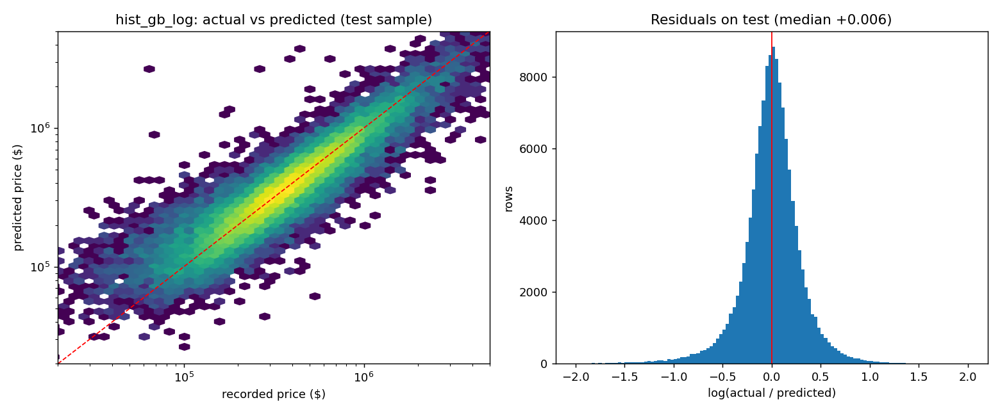
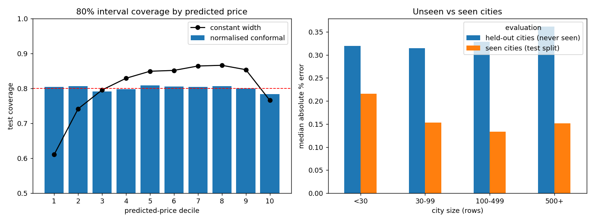

# Phase 4 model comparison (generated by `python src/train_model.py`)

**Target.** The recorded `price` of `sold`-status records. It is not documented as a verified completed-sale price, so all estimates describe this dataset's recorded prices, not market value or an appraisal.

Data source: postgresql warehouse (dw.fact_property_listing); matches `sold_clean.parquet`: True. Seed 42.

## Features

- Location: `state`, `city` (encoded by a hierarchical target encoder learned on training rows only; unseen cities fall back to their state).
- Numeric: `bed`, `bath`, log house size, log lot size, plus missing-value indicators.
- Excluded: price_per_sqft (derived from the target); prev_sold_date / sold_year (meaning unverified); street, brokered_by, raw_row_id, property_key (identifiers); zip_code (not a user-facing input; high cardinality).

## Leakage controls

- Each property group (street code + zip) is hashed to one split, so a property never appears in two splits (asserted in code). Splits are 60% train, 10% validation, 10% calibration, 20% test.
- Imputers, scalers and the target encoder are fitted on training rows inside the pipeline (target encoding is cross-fitted).
- Validation chose the model; the calibration split only sets interval widths; the test split was evaluated once at the end.

| split | rows | groups | singleton_key_rows | cities | share_of_rows |
|---|---|---|---|---|---|
| train | 418,165 | 418,011 | 1,082 | 14,242 | 0.601 |
| validation | 69,769 | 69,730 | 181 | 8,165 | 0.100 |
| calibration | 69,253 | 69,217 | 186 | 8,179 | 0.099 |
| test | 139,100 | 139,051 | 303 | 10,486 | 0.200 |

Group-key reliability: 1,752 rows have no key (singleton groups); only 196 groups have more than one row (474 rows), and in 134 of them the rows differ in bed/bath/size, so the key sometimes joins different units. 2,806 street codes occur in several zips. The key cannot link the same property listed under a missing key. Repeated sold properties are rare, so leakage risk is small but not zero.

## Model comparison

Selection used **validation MAE**; test metrics are reported afterwards for every candidate (dollars; R2 on dollars).

| model | val_MAE | val_RMSE | val_R2 | val_MedAE | val_MdAPE | val_R2_log | val_fit_seconds | val_model_size_mb | test_MAE | test_RMSE | test_R2 | test_MedAE | test_MdAPE | test_predict_seconds |
|---|---|---|---|---|---|---|---|---|---|---|---|---|---|---|
| dummy_median | 280,877 | 681,976 | -0.044 | 159,900 | 0.438 | -0.000 | 0.011 | 0.001 | 282,014 | 712,215 | -0.041 | 160,000 | 0.438 | 0.020 |
| ridge_log | 125,266 | 404,730 | 0.632 | 60,756 | 0.176 | 0.792 | 1.564 | 0.640 | 124,699 | 424,927 | 0.629 | 60,722 | 0.175 | 0.150 |
| random_forest_log | 111,237 | 377,327 | 0.680 | 51,731 | 0.152 | 0.827 | 15.400 | 60.531 | 111,134 | 424,167 | 0.631 | 52,179 | 0.151 | 0.754 |
| hist_gb_log | 106,871 | 346,754 | 0.730 | 50,899 | 0.148 | 0.841 | 13.235 | 6.173 | 106,982 | 383,269 | 0.699 | 51,125 | 0.149 | 1.965 |
| hist_gb_raw | 113,767 | 352,940 | 0.720 | 55,343 | 0.157 | 0.799 | 4.587 | 2.174 | 113,117 | 381,184 | 0.702 | 55,727 | 0.157 | 1.044 |

**Selected: `hist_gb_log`.** Test: MAE $106,982, RMSE $383,269, R2 0.699, median absolute error $51,125, median absolute % error 14.9%, on 139,100 test rows. In a validation-only check made before the encoder change below, larger boosting settings (up to 1,500 iterations / 127 leaves) changed validation MAE by under 0.5%, so model capacity was not the bottleneck; the information in the features is.

### Development note: why the location encoder is size-adjusted

The first full run showed a systematic bias in Florida (median log residual +0.19 in train, validation, calibration and test alike, other states about 0.00). Cause: Florida and Texas have the same unconditional mean log price (12.697), and an unconditional state/city mean mixes price level with house-size mix, so the model could not tell the states apart. Fix: the encoder first removes the effect of size, bedrooms and bathrooms with a linear fit learned on training rows, then encodes state/city means of the remainder. Validation-only comparison (scratch experiment, same split and model settings):

| variant | val_MAE | val_MdAPE | Florida_median_log_resid |
|---|---|---|---|
| unadjusted encoder (first run) | 115,785 | 0.163 | 0.197 |
| + state one-hot | 112,207 | 0.155 | 0.007 |
| size-adjusted encoder (adopted) | 106,871 | 0.148 | 0.014 |
| size-adjusted + state one-hot | 106,565 | 0.147 | 0.010 |

**Test-set exposure disclosure:** the Florida bias was noticed in the by-state test table of the first full run, so the test split had been viewed once before this change. The change itself was designed and chosen using training/validation residuals and validation metrics only. The reported test numbers come from the rerun of the final pipeline.

### Test performance by price bracket

| price_bracket | n | MAE | MedAE | MdAPE | median_log_bias | median_price |
|---|---|---|---|---|---|---|
| <100k | 6,810 | 55,191 | 39,576 | 0.581 | 0.458 | 74,999 |
| 100-200k | 21,118 | 44,163 | 30,243 | 0.193 | 0.075 | 160,000 |
| 200-400k | 51,504 | 52,862 | 39,005 | 0.133 | -0.001 | 299,900 |
| 400-700k | 36,176 | 87,936 | 64,605 | 0.125 | -0.033 | 519,900 |
| 700k-1M | 12,624 | 154,187 | 115,892 | 0.140 | -0.058 | 825,000 |
| 1-2M | 8,219 | 312,672 | 244,116 | 0.181 | -0.114 | 1,325,000 |
| >2M | 2,649 | 1,190,141 | 737,303 | 0.255 | -0.216 | 2,880,000 |

### Test performance by city size (rows in the dataset)

| city_size | n | MAE | MedAE | MdAPE | median_log_bias | median_price |
|---|---|---|---|---|---|---|
| <30 | 15,731 | 112,948 | 53,658 | 0.215 | -0.023 | 259,900 |
| 30-99 | 21,565 | 96,809 | 47,778 | 0.150 | -0.010 | 339,000 |
| 100-499 | 49,980 | 100,396 | 48,308 | 0.132 | -0.002 | 385,000 |
| 500+ | 51,824 | 115,757 | 54,785 | 0.151 | -0.006 | 383,000 |

### Test performance by state (states with at least 100 test rows)

| state | n | MAE | MedAE | MdAPE | median_log_bias | median_price |
|---|---|---|---|---|---|---|
| California | 23,372 | 184,519 | 85,935 | 0.126 | -0.001 | 699,000 |
| Texas | 14,262 | 79,559 | 42,928 | 0.137 | 0.005 | 315,526 |
| Florida | 13,860 | 122,761 | 53,382 | 0.174 | -0.009 | 325,000 |
| Washington | 6,679 | 122,557 | 67,856 | 0.129 | -0.006 | 535,000 |
| Virginia | 6,219 | 86,337 | 53,351 | 0.136 | 0.003 | 395,000 |
| Arizona | 6,006 | 79,893 | 44,627 | 0.118 | -0.002 | 399,000 |
| Massachusetts | 5,504 | 129,331 | 63,551 | 0.134 | -0.002 | 499,000 |
| Illinois | 5,458 | 64,313 | 36,232 | 0.155 | -0.019 | 250,000 |
| Pennsylvania | 5,091 | 71,551 | 43,280 | 0.180 | -0.018 | 249,000 |
| Georgia | 4,856 | 76,497 | 45,015 | 0.154 | -0.012 | 308,000 |
| New York | 4,675 | 163,800 | 51,194 | 0.196 | -0.010 | 252,900 |
| Maryland | 4,653 | 86,681 | 52,268 | 0.142 | -0.011 | 375,000 |
| Ohio | 3,999 | 46,614 | 31,111 | 0.196 | -0.034 | 156,000 |
| North Carolina | 3,664 | 78,834 | 45,377 | 0.160 | -0.008 | 300,000 |
| Minnesota | 3,506 | 72,112 | 45,776 | 0.158 | -0.013 | 299,900 |
| Oklahoma | 3,300 | 54,654 | 34,535 | 0.159 | -0.000 | 219,378 |
| Missouri | 2,635 | 59,132 | 38,272 | 0.189 | -0.024 | 215,000 |
| Oregon | 2,206 | 97,362 | 63,815 | 0.127 | -0.016 | 500,000 |
| Iowa | 1,690 | 50,618 | 34,260 | 0.176 | -0.031 | 199,000 |
| New Jersey | 1,537 | 88,578 | 50,772 | 0.153 | -0.027 | 349,750 |
| Wisconsin | 1,519 | 65,951 | 41,345 | 0.183 | 0.014 | 245,000 |
| New Mexico | 1,343 | 69,772 | 41,900 | 0.146 | 0.009 | 285,000 |
| Alabama | 1,236 | 64,455 | 40,928 | 0.192 | -0.041 | 229,900 |
| Kentucky | 1,097 | 53,686 | 35,155 | 0.177 | -0.012 | 209,000 |
| South Carolina | 1,055 | 97,871 | 43,193 | 0.160 | -0.036 | 290,000 |
| Michigan | 1,008 | 61,253 | 37,672 | 0.219 | -0.032 | 184,900 |
| Rhode Island | 897 | 89,545 | 49,686 | 0.139 | 0.002 | 349,900 |
| Colorado | 864 | 113,026 | 57,234 | 0.134 | -0.003 | 467,688 |
| Idaho | 805 | 73,557 | 42,380 | 0.104 | 0.020 | 439,900 |
| Kansas | 759 | 38,820 | 27,735 | 0.199 | -0.008 | 144,900 |
| Nevada | 696 | 153,802 | 59,505 | 0.117 | 0.012 | 479,975 |
| District of Columbia | 693 | 216,171 | 136,419 | 0.207 | -0.066 | 699,000 |
| Tennessee | 666 | 77,935 | 44,271 | 0.167 | -0.040 | 270,000 |
| Arkansas | 618 | 62,820 | 36,725 | 0.143 | 0.052 | 269,950 |
| Delaware | 598 | 76,580 | 52,341 | 0.173 | -0.037 | 306,500 |
| West Virginia | 587 | 50,869 | 39,616 | 0.199 | -0.059 | 199,900 |
| Louisiana | 492 | 57,619 | 38,735 | 0.205 | -0.010 | 193,250 |
| Montana | 402 | 144,942 | 86,086 | 0.202 | 0.022 | 451,950 |
| Mississippi | 261 | 52,856 | 32,112 | 0.191 | -0.050 | 180,000 |

## Missing-data strategies

A = trained on the 418,165 complete-case training rows. B = A plus the 68,864 training rows that lack bed, bath or house size (median imputation fitted on training data, with missing indicators; prices are never imputed). Both are scored on the same complete-case rows; B-only coverage is the incomplete rows.

| model | strategy | evaluated_on | n | MAE | RMSE | R2 | MdAPE |
|---|---|---|---|---|---|---|---|
| hist_gb_log | A complete-case training | validation: complete-case rows | 69,769 | 106,871 | 346,754 | 0.730 | 0.148 |
| hist_gb_log | A complete-case training | validation: incomplete rows, house_size missing | 10,347 | 245,528 | 479,514 | 0.190 | 0.873 |
| hist_gb_log | A complete-case training | validation: incomplete rows, only bed/bath missing | 1,171 | 220,525 | 577,302 | 0.583 | 0.286 |
| hist_gb_log | B + imputed incomplete rows | validation: complete-case rows | 69,769 | 108,874 | 352,258 | 0.721 | 0.152 |
| hist_gb_log | B + imputed incomplete rows | validation: incomplete rows, house_size missing | 10,347 | 119,081 | 395,971 | 0.447 | 0.325 |
| hist_gb_log | B + imputed incomplete rows | validation: incomplete rows, only bed/bath missing | 1,171 | 177,520 | 416,541 | 0.783 | 0.238 |
| hist_gb_log | A complete-case training | test: complete-case rows | 139,100 | 106,982 | 383,269 | 0.699 | 0.149 |
| hist_gb_log | A complete-case training | test: incomplete rows, house_size missing | 20,533 | 257,528 | 714,081 | 0.126 | 0.904 |
| hist_gb_log | A complete-case training | test: incomplete rows, only bed/bath missing | 2,156 | 219,597 | 507,303 | 0.654 | 0.287 |
| hist_gb_log | B + imputed incomplete rows | test: complete-case rows | 139,100 | 108,581 | 379,934 | 0.704 | 0.153 |
| hist_gb_log | B + imputed incomplete rows | test: incomplete rows, house_size missing | 20,533 | 129,236 | 612,850 | 0.356 | 0.331 |
| hist_gb_log | B + imputed incomplete rows | test: incomplete rows, only bed/bath missing | 2,156 | 182,979 | 417,652 | 0.765 | 0.249 |
| ridge_log | A complete-case training | validation: complete-case rows | 69,769 | 125,266 | 404,730 | 0.632 | 0.176 |
| ridge_log | A complete-case training | validation: incomplete rows, house_size missing | 10,347 | 246,127 | 492,135 | 0.146 | 0.816 |
| ridge_log | A complete-case training | validation: incomplete rows, only bed/bath missing | 1,171 | 215,248 | 708,984 | 0.371 | 0.277 |
| ridge_log | B + imputed incomplete rows | validation: complete-case rows | 69,769 | 134,480 | 475,006 | 0.493 | 0.187 |
| ridge_log | B + imputed incomplete rows | validation: incomplete rows, house_size missing | 10,347 | 154,743 | 470,725 | 0.219 | 0.424 |
| ridge_log | B + imputed incomplete rows | validation: incomplete rows, only bed/bath missing | 1,171 | 339,232 | 732,549 | 0.328 | 0.516 |
| ridge_log | A complete-case training | test: complete-case rows | 139,100 | 124,699 | 424,927 | 0.629 | 0.175 |
| ridge_log | A complete-case training | test: incomplete rows, house_size missing | 20,533 | 255,592 | 710,262 | 0.135 | 0.836 |
| ridge_log | A complete-case training | test: incomplete rows, only bed/bath missing | 2,156 | 214,318 | 478,467 | 0.692 | 0.289 |
| ridge_log | B + imputed incomplete rows | test: complete-case rows | 139,100 | 133,519 | 456,177 | 0.573 | 0.185 |
| ridge_log | B + imputed incomplete rows | test: incomplete rows, house_size missing | 20,533 | 163,939 | 700,700 | 0.158 | 0.425 |
| ridge_log | B + imputed incomplete rows | test: incomplete rows, only bed/bath missing | 2,156 | 327,876 | 659,430 | 0.415 | 0.510 |

## Geographic generalisation (whole cities held out)

2,341 cities were removed from training entirely; their 86,139 rows are the 'never seen' evaluation. 'Seen cities' are test-split rows from cities that remained in training.

| evaluation | city_size | n | MAE | MedAE | MdAPE | R2 | R2_log |
|---|---|---|---|---|---|---|---|
| held-out cities (never seen) | all | 86,139 | 211,408 | 102,583 | 0.333 | 0.436 | 0.525 |
| held-out cities (never seen) | <30 | 11,145 | 162,815 | 76,613 | 0.319 | 0.377 | 0.554 |
| held-out cities (never seen) | 30-99 | 16,165 | 208,673 | 96,849 | 0.314 | 0.404 | 0.554 |
| held-out cities (never seen) | 100-499 | 35,079 | 247,035 | 111,556 | 0.328 | 0.455 | 0.512 |
| held-out cities (never seen) | 500+ | 23,750 | 183,451 | 109,094 | 0.361 | 0.404 | 0.447 |
| seen cities (test split) | all | 121,948 | 109,058 | 51,692 | 0.150 | 0.669 | 0.837 |
| seen cities (test split) | <30 | 13,523 | 112,964 | 54,131 | 0.216 | 0.582 | 0.743 |
| seen cities (test split) | 30-99 | 18,283 | 97,536 | 47,947 | 0.153 | 0.755 | 0.846 |
| seen cities (test split) | 100-499 | 43,089 | 100,313 | 48,931 | 0.133 | 0.803 | 0.862 |
| seen cities (test split) | 500+ | 47,053 | 120,420 | 55,543 | 0.151 | 0.585 | 0.831 |

## Location support

Candidate minimum training-row thresholds (error measured on validation+calibration rows, never the test split):

| group | heldout_rows | cities | MdAPE | MAE | share_of_rows_over_0.5_APE |
|---|---|---|---|---|---|
| n_train >= 30 | 115,731 | 2,435 | 0.142 | 108,451 | 0.076 |
| n_train < 30 | 23,291 | 7,977 | 0.193 | 110,063 | 0.141 |
| n_train >= 100 | 86,750 | 835 | 0.141 | 109,314 | 0.077 |
| n_train < 100 | 52,272 | 9,577 | 0.163 | 107,738 | 0.103 |
| n_train >= 500 | 37,124 | 84 | 0.164 | 128,064 | 0.099 |
| n_train < 500 | 101,898 | 10,328 | 0.143 | 101,674 | 0.082 |

Policy: **supported** = at least 100 training rows, at least 10 held-out rows and held-out median error <= 25%; **limited** = at least 30 training rows but failing a supported criterion (warn, show a wider-uncertainty message); **unsupported** = fewer rows or a city not in the table (no prediction). Cities in the table:

| status | cities | rows |
|---|---|---|
| limited | 1,643 | 179,078 |
| supported | 792 | 401,851 |
| unsupported | 13,655 | 115,358 |

Confirmation on the untouched test split, by city status:

| status | n | MAE | MedAE | MdAPE | median_log_bias | median_price |
|---|---|---|---|---|---|---|
| limited | 35,756 | 126,182 | 51,737 | 0.158 | -0.007 | 349,900 |
| supported | 79,934 | 98,694 | 50,530 | 0.135 | -0.003 | 393,018 |
| unsupported | 23,410 | 105,957 | 52,153 | 0.193 | -0.019 | 280,000 |

Per-city results: `reports/location_evaluation.csv`; app-facing table: `models/location_support.csv`.

## Prediction intervals

Method: split conformal prediction on log price. A small gradient-boosting model, fitted on the validation split, predicts the typical size of the log residual for a home; the calibration split sets a single multiplier (80%: 1.543, 90%: 2.105). The interval is `estimate * exp(+/- multiplier * predicted spread)`. A constant-width alternative is shown for comparison.

| nominal | method | coverage | mean_width_$ | median_width_$ | median_hi/lo |
|---|---|---|---|---|---|
| 0.800 | normalised conformal (selected) | 0.801 | 322,062 | 199,508 | 1.820 |
| 0.800 | constant-width conformal | 0.802 | 323,488 | 238,382 | 1.925 |
| 0.900 | normalised conformal (selected) | 0.902 | 448,847 | 276,286 | 2.264 |
| 0.900 | constant-width conformal | 0.901 | 476,731 | 351,308 | 2.578 |

### 80% interval coverage by predicted-price decile (usable at prediction time)

| pred_decile | n | coverage_80 | constant_width_coverage | median_width | median_price |
|---|---|---|---|---|---|
| 1 | 14,250 | 0.804 | 0.611 | 113,067 | 121,900 |
| 2 | 14,044 | 0.807 | 0.741 | 135,459 | 189,000 |
| 3 | 14,128 | 0.791 | 0.795 | 146,876 | 239,900 |
| 4 | 13,842 | 0.798 | 0.829 | 157,654 | 285,000 |
| 5 | 14,058 | 0.809 | 0.849 | 177,229 | 336,000 |
| 6 | 13,601 | 0.806 | 0.851 | 202,126 | 390,000 |
| 7 | 13,871 | 0.804 | 0.864 | 236,042 | 459,000 |
| 8 | 13,529 | 0.806 | 0.866 | 288,096 | 560,000 |
| 9 | 14,086 | 0.800 | 0.853 | 383,136 | 729,000 |
| 10 | 13,691 | 0.783 | 0.766 | 870,116 | 1,279,900 |

### By actual price bracket (conditioning on the outcome, so coverage naturally drifts for the extremes)

| price_bracket | n | coverage_80 | constant_width_coverage | median_width | median_price |
|---|---|---|---|---|---|
| <100k | 6,810 | 0.546 | 0.357 | 114,881 | 74,999 |
| 100-200k | 21,118 | 0.806 | 0.730 | 129,904 | 160,000 |
| 200-400k | 51,504 | 0.844 | 0.862 | 167,201 | 299,900 |
| 400-700k | 36,176 | 0.816 | 0.866 | 253,024 | 519,900 |
| 700k-1M | 12,624 | 0.789 | 0.825 | 415,430 | 825,000 |
| 1-2M | 8,219 | 0.725 | 0.733 | 786,987 | 1,325,000 |
| >2M | 2,649 | 0.664 | 0.572 | 1,927,449 | 2,880,000 |

### By location status

| status | n | coverage_80 | constant_width_coverage | median_width | median_price |
|---|---|---|---|---|---|
| limited | 35,756 | 0.790 | 0.782 | 194,272 | 349,900 |
| supported | 79,934 | 0.805 | 0.840 | 198,587 | 393,018 |
| unsupported | 23,410 | 0.802 | 0.702 | 208,554 | 280,000 |

### By state (at least 200 test rows)

| state | n | coverage_80 | constant_width_coverage | median_width | median_price |
|---|---|---|---|---|---|
| Alabama | 1,236 | 0.761 | 0.691 | 152,352 | 229,900 |
| Arizona | 6,006 | 0.798 | 0.872 | 177,043 | 399,000 |
| Arkansas | 618 | 0.786 | 0.819 | 153,099 | 269,950 |
| California | 23,372 | 0.807 | 0.852 | 346,455 | 699,000 |
| Colorado | 864 | 0.797 | 0.850 | 216,852 | 467,688 |
| Delaware | 598 | 0.732 | 0.779 | 158,432 | 306,500 |
| District of Columbia | 693 | 0.747 | 0.704 | 489,222 | 699,000 |
| Florida | 13,860 | 0.783 | 0.745 | 198,120 | 325,000 |
| Georgia | 4,856 | 0.795 | 0.797 | 175,728 | 308,000 |
| Idaho | 805 | 0.817 | 0.892 | 187,192 | 439,900 |
| Illinois | 5,458 | 0.825 | 0.787 | 150,192 | 250,000 |
| Iowa | 1,690 | 0.787 | 0.741 | 127,062 | 199,000 |
| Kansas | 759 | 0.842 | 0.722 | 124,549 | 144,900 |
| Kentucky | 1,097 | 0.791 | 0.766 | 139,347 | 209,000 |
| Louisiana | 492 | 0.746 | 0.703 | 130,841 | 193,250 |
| Maryland | 4,653 | 0.813 | 0.827 | 204,654 | 375,000 |
| Massachusetts | 5,504 | 0.806 | 0.846 | 262,836 | 499,000 |
| Michigan | 1,008 | 0.799 | 0.661 | 141,254 | 184,900 |
| Minnesota | 3,506 | 0.812 | 0.795 | 179,268 | 299,900 |
| Mississippi | 261 | 0.824 | 0.697 | 138,881 | 180,000 |
| Missouri | 2,635 | 0.799 | 0.725 | 147,170 | 215,000 |
| Montana | 402 | 0.697 | 0.692 | 272,390 | 451,950 |
| Nevada | 696 | 0.783 | 0.884 | 199,993 | 479,975 |
| New Jersey | 1,537 | 0.826 | 0.811 | 209,042 | 349,750 |
| New Mexico | 1,343 | 0.788 | 0.817 | 156,415 | 285,000 |
| New York | 4,675 | 0.789 | 0.707 | 185,162 | 252,900 |
| North Carolina | 3,664 | 0.791 | 0.791 | 181,290 | 300,000 |
| Ohio | 3,999 | 0.822 | 0.701 | 129,574 | 156,000 |
| Oklahoma | 3,300 | 0.816 | 0.784 | 134,772 | 219,378 |
| Oregon | 2,206 | 0.807 | 0.852 | 242,478 | 500,000 |
| Pennsylvania | 5,091 | 0.797 | 0.740 | 164,010 | 249,000 |
| Rhode Island | 897 | 0.832 | 0.834 | 217,564 | 349,900 |
| South Carolina | 1,055 | 0.786 | 0.776 | 170,704 | 290,000 |
| Tennessee | 666 | 0.799 | 0.754 | 176,190 | 270,000 |
| Texas | 14,262 | 0.806 | 0.830 | 175,618 | 315,526 |
| Virginia | 6,219 | 0.808 | 0.856 | 207,270 | 395,000 |
| Washington | 6,679 | 0.805 | 0.856 | 264,279 | 535,000 |
| West Virginia | 587 | 0.775 | 0.700 | 140,509 | 199,900 |
| Wisconsin | 1,519 | 0.778 | 0.729 | 163,665 | 245,000 |

Coverage is marginal over the test distribution and holds on average if the future data resemble this snapshot (Oct 2021 - May 2022, per `prev_sold_date`). It is not a guarantee for an individual home or city, and it describes the recorded dataset target, not market value or an appraisal.
