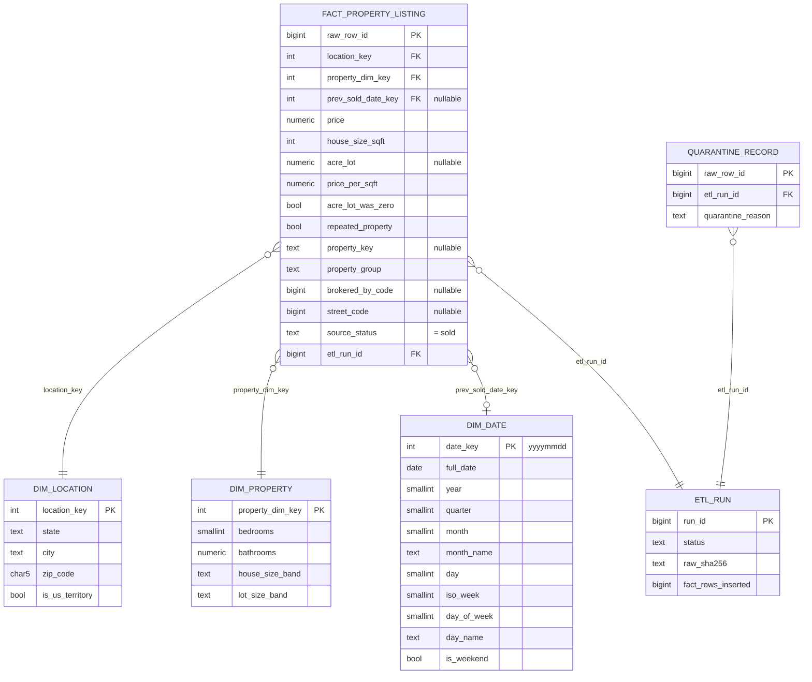

# Data warehouse schema (Phase 3)

Database: PostgreSQL (written and tested against 17.2). Schemas: `staging`, `dw`, `audit`.
DDL: `sql/create_warehouse.sql`. Transform: `sql/load_warehouse.sql`. Driver: `src/warehouse_etl.py`.

**Target caveat.** `price` is the recorded price of a record whose source `status` is `sold`. The dataset's
documentation for this field has not been verified, so it is not described anywhere as a verified completed-sale
price. The same applies to `prev_sold_date` for these rows (see *Date dimension*).

## Star schema

## Grain

`dw.fact_property_listing`: **one retained source record per row** - one row of the raw CSV with
`status = 'sold'` that passed every Phase 2 rule. The primary key `raw_row_id` is the 0-based position of that row in
`realtor-data.zip.csv`. A physical property can therefore appear in several fact rows (196 properties do, 474 rows);
`property_group` marks them so train/test splits can keep them together.

## Tables

| Table | Key | Rows (tested load) | Notes |
|---|---|---:|---|
| `dw.fact_property_listing` | PK `raw_row_id` | 696,287 | FKs to location, property, date, etl_run |
| `dw.dim_location` | PK `location_key`; unique `(state, city, zip_code)` | 22,128 | `is_us_territory` is derived from state (Puerto Rico, Guam, Virgin Islands) |
| `dw.dim_property` | PK `property_dim_key`; unique `(bedrooms, bathrooms, house_size_band, lot_size_band)` | 1,939 | low-cardinality descriptors only |
| `dw.dim_date` | PK `date_key` (yyyymmdd); unique `full_date` | 201 | every day from 2021-10-18 to 2022-05-06 |
| `audit.etl_run` | PK `run_id` | one per load | status, timings, source SHA-256s, insert/update/delete counts, error text |
| `audit.quarantine_record` | PK `raw_row_id`; FK `etl_run_id` | 704 | rows held out by Phase 2, with reason and every rule they tripped |
| `staging.sold_clean`, `staging.quarantine` | none (deliberately) | 696,287 / 704 | verbatim Parquet copies, replaced each load |

## Fact columns and constraints

| Column | Type | Constraint |
|---|---|---|
| `raw_row_id` | BIGINT | PRIMARY KEY |
| `location_key` | INTEGER | NOT NULL, FK `dim_location` |
| `property_dim_key` | INTEGER | NOT NULL, FK `dim_property` |
| `prev_sold_date_key` | INTEGER | FK `dim_date`; NULL for the 1 row whose source date is missing |
| `price` | NUMERIC(14,2) | NOT NULL, CHECK > 0 |
| `house_size_sqft` | INTEGER | NOT NULL, CHECK > 0 (the source values are whole numbers) |
| `acre_lot` | NUMERIC(10,4) | NULL = unknown; CHECK > 0 (zeros were converted to NULL in Phase 2) |
| `price_per_sqft` | NUMERIC(12,2) | NOT NULL, CHECK > 0; derived in Phase 2 |
| `acre_lot_was_zero`, `repeated_property` | BOOLEAN | NOT NULL |
| `property_key` | TEXT | NULL when the street code is missing (1,752 rows) |
| `property_group` | TEXT | NOT NULL; equals `property_key`, or `row_<raw_row_id>` when the key is NULL |
| `brokered_by_code`, `street_code` | BIGINT | NULL when missing; anonymised source codes, not names or addresses |
| `source_status` | TEXT | NOT NULL, CHECK = 'sold' |
| `etl_run_id` | BIGINT | NOT NULL, FK `audit.etl_run`; the run that last inserted or changed the row |

Indexes: one per foreign key on the fact table, plus `property_group`; `(state, city)` on `dim_location`; `raw_row_id` on
`staging.sold_clean` (used by the validation joins).

## Design decisions

- **Why `dim_property` holds bands, not exact sizes.** Exact `house_size` and `acre_lot` are nearly unique per row, so a
  dimension keyed on them would be a copy of the fact table. They stay on the fact table as numeric measures, and the
  dimension holds bedrooms, bathrooms and bands:
  - House size: under 1,000; 1,000-1,499; 1,500-1,999; 2,000-2,999; 3,000-3,999; 4,000+ sqft.
  - Lot size: unknown; under 0.25; 0.25-0.49; 0.5-0.99; 1-4.99; 5-19.99; 20+ acres.
  - These band edges are project choices, not source definitions.
- **Date dimension.** The meaning of `prev_sold_date` for `sold` rows is not documented. All 696,287 rows span
  2021-10-18 to 2022-05-06, which is consistent with a sale date, but that is an inference. The warehouse therefore
  stores the date under the source's own name (`prev_sold_date_key`) and does not call it a sale or closing date. If the
  meaning turns out to differ, `dim_date` and that one column can be dropped without affecting the rest of the schema.
- **Bathrooms.** Stored as `NUMERIC(4,1)` although every value in this snapshot is whole, so half-baths in future data
  would load without a schema change.
- **Quarantined rows.** They are not in the star schema. `audit.quarantine_record` keeps them for review. The thresholds
  behind them (price under $1,000, bed/bath over 20, house size under 200 or over 50,000 sqft, price per sqft outside
  $5-$10,000, lots over 1,000 acres, zip/state disagreement) are project-specific rules, not industry standards.
- **Not modelled.** `status` has a single value, so there is no status dimension. `brokered_by` and `street` are
  anonymised numeric codes with no descriptive attributes, so they are fact columns, not dimensions.
